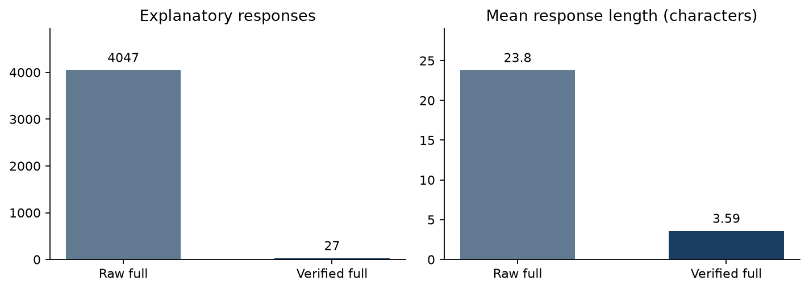
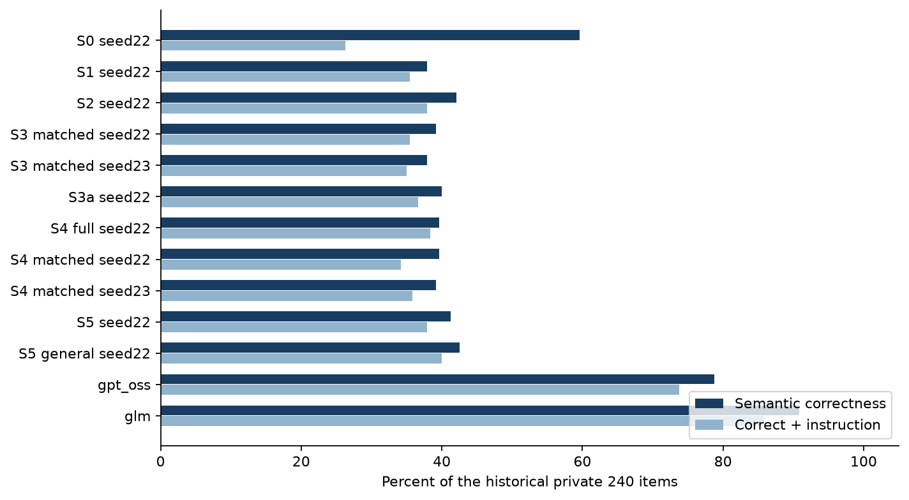
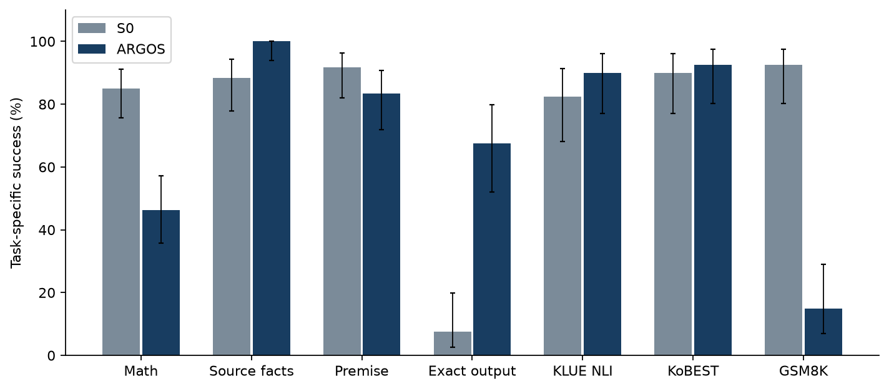
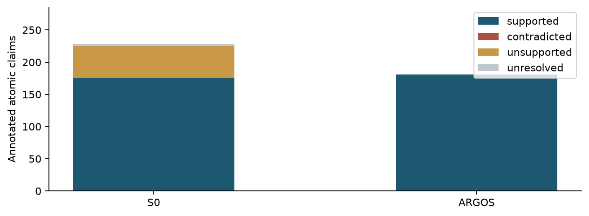

# CoMPaSS ARGOS 최종 연구 보고서

2026년 10월 27일 | 단일 AI 검수와 실제 실행 기록에 근거한 종합 보고서

## 연구 요약

본 연구는 서로 다른 공개 가중치 언어모델의 응답을 수집하고, 외부 기준으로 검증한 자료를 같은 학생 모델에 학습시켰을 때 무엇이 달라지는지 조사하였다. 핵심 비교는 교사 응답을 많이 모으는 효과와 검증된 응답을 고르는 효과를 구분하는 데 있다. 기반 학생은 EXAONE 3.5 7.8B Instruct이며, 교사는 GPT OSS 20B와 GLM 4.7 Flash이다.

전체 연구에서 가장 일관되게 확인된 것은 형식 준수와 내용 정확도가 함께 움직이지 않는다는 사실이다. 본실험에서 선택한 학생은 기존 비공개 과제의 내용과 지시를 동시에 만족한 비율이 높았지만, 기존 STEM 100문항의 의미 정답은 기반 모델 50개에서 1개로 감소했다. 정치 역사 국제관계 40문항에서는 37개를 통과했다. 이 두 결과를 하나의 점수로 합쳐 전반적인 성능 향상이라고 부르면 중요한 실패를 가리게 된다.

본 보고서는 초기 계획서의 항목을 채웠다는 확인서가 아니다. 실제 실행 중 수정한 데이터 구성, GPU 환경, 검수 방식, 출력 한도, 진단 실험과 후속 학습을 시간 순서와 증거의 성격에 따라 정리한 종합 연구 보고서이다. 초기 계획서는 연구 질문의 출발점과 변경 이력을 설명하는 자료로 사용한다. 수행하지 않은 실험을 억지로 추가하거나, 이미 실패한 학습을 성공할 때까지 반복하여 결론을 바꾸지 않았다.

이번 마무리 단계에서는 기존 모델을 동결하고 신규 비공개 240문항과 공개 보조 120문항을 준비하였다. 새로운 문항의 정답과 실행 조건을 해시로 봉인한 다음 기반 모델과 선택 학생을 평가하였다. 이 평가는 기존 140문항의 재사용과 구분되는 후속 검증이다. 다만 절차적 문항의 생성 계열, 출제와 검수를 담당한 AI 흐름, 공개 자료의 사전학습 노출 가능성까지 독립적이라고 주장하지 않는다.

자료 검수와 보고서 작성은 Codex AI가 수행하였다. 사용자 요청에 따라 사람 검수자를 AI로 대체했으며, 실제 사람 검수자 수는 0명이다. 한 AI의 반복 판단을 두 사람의 독립 판단으로 계산하지 않았다. 따라서 독립 평가자 간 일치도와 Cohen 카파는 산출 대상이 아니다. 대신 판단 원문과 적용 기준, 자동 채점이 해결하지 못한 사례, 기존 동일 응답의 판정 변동을 보존하였다.

신규 수학 80문항의 확인된 정답은 S0 68개, ARGOS 37개였다. 새 문항에서도 결과를 바꾸기 위한 추가 학습이나 후보 교체는 하지 않았다. 아래 본문은 기존 실험과 신규 평가를 구분하고, 부록은 모든 관측 조건을 보존한다.

최종 연구 상태

| 항목 | 실제 수행 및 판단 |
| --- | --- |
| 본실험 | 학생 학습 10회와 기존 13조건 평가 완료 |
| 후속 수학 | 교사 재수집 및 5개 체크포인트 보존, 새 후보 채택 없음 |
| 신규 확인 | 비공개 240문항과 공개 120문항 × 2모델 |
| 검수 | 단일 AI, 사람 0명, 독립 평가자 카파 미산출 |
| 모델 선택 | 기존 S5_general_control 유지, 범용 우월성 주장 없음 |
| 공개 | 보고서와 집계 및 재현 코드, 비공개 문항과 가중치 제외 |

## 1 연구 질문과 해석의 기준

연구 질문은 네 가지다. 첫째, 같은 질문과 감독 토큰 예산을 맞춘 경우 검증된 교사 응답이 혼합 원본 응답보다 좋은가. 둘째, 한국어 원천 자료를 추가한 조건이 같은 양의 일반 자료를 추가한 조건보다 좋은가. 셋째, 실용적으로 선택한 학생이 계산 능력과 기존의 강점을 함께 유지하는가. 넷째, 수집과 검증, 학습, 평가를 재현 가능한 기록으로 연결할 수 있는가.

첫 번째 질문은 S3_matched와 S4_teacher_only의 대응 비교가 주된 근거다. 전체 원본과 전체 검증본의 비교는 질문 수와 답변 길이까지 달라지므로 검증만의 효과를 분리하지 못한다. 두 번째 질문에서도 한국어 자료와 일반 대조 자료는 언어 외에 출처와 주제, 문맥 길이, 주석 방식이 다르다. 따라서 결과 차이를 한국어 자체의 순수한 인과 효과로 해석하지 않는다.

세 번째 질문은 기존 최종 평가로 모델을 선택했다는 사실 때문에 별도의 확인이 필요해졌다. 기존 결과는 모델 선택과 오류 진단에 사용한 개발 증거로도 기능했다. 이번 신규 문항 평가에서는 모델과 질문, 정답, 출력 상한을 결과 확인 전에 확정했다. 결과가 불리하더라도 다른 후보로 바꾸거나 같은 문항에 맞춰 재학습하지 않는다.

연구 완결의 기준은 성능 상승의 유무가 아니다. 어떤 자료와 설정에서 어떤 변화가 발생했고, 대안 설명은 무엇이며, 어느 주장까지 증거가 지지하는지 밝히는 것이 기준이다. 수학 회복 실패, 검증 필터가 만든 자료 편중, 소수 학습 시드, 단일 AI 검수도 결과의 일부다. 본 연구는 검증된 자료의 활용이 언제나 성능을 높인다는 보편 명제를 입증하지 않는다.

## 2 이론적 배경과 본 실험의 위치

출력 기반 지식 증류는 교사의 답변을 학생의 감독 학습 자료로 사용하는 방식이다. 교사의 분포 전체를 전달하는 로짓 기반 증류와 달리, 본 연구는 저장한 최종 답변 텍스트를 이용한다. 여러 교사의 답변을 섞으면 응답의 범위와 다양성이 늘 수 있지만, 교사들이 공유하는 오류와 형식 편향도 전달될 수 있다. 교사 간 합의만으로 정답을 결정하지 않은 이유다.

LoRA는 모든 가중치를 갱신하는 대신 일부 선형층에 저랭크 행렬을 추가하는 미세조정 방법이다. 본 실험은 q_proj, k_proj, v_proj, out_proj에 rank 16 어댑터를 사용했다. QLoRA의 핵심은 양자화한 기반 가중치를 유지하면서 어댑터를 학습하는 것이다. 본 실행은 NF4 4비트와 BF16 연산을 사용했으며, 메모리가 부족할 때 비양자화 학습으로 바꾸는 경로를 허용하지 않았다. [R1][R2][R3]

본 연구의 검증 필터는 정답률뿐 아니라 학습 분포도 바꾸었다. 수학의 짧은 정답은 기계적으로 판정하기 쉽고, 긴 설명의 모든 주장과 근거는 판정하기 어렵다. 검토가 어려운 설명을 보류하면 학습 자료가 짧은 정답 위주로 바뀔 수 있다. 이 현상은 검증의 정확성과 별개의 문제이며, 검증 통과율과 답변 길이, 유형별 잔존율을 함께 보아야 한다.

공개 벤치마크는 비교 가능한 자료를 제공하지만 이미 사전학습에 노출되었는지 완전히 확인하기 어렵다. 신규 비공개 문항도 출제 방식이 훈련 자료와 비슷하면 넓은 일반화의 근거가 되지 못한다. 따라서 본 보고서는 기존 문항, 신규 절차적 문항, 제공 자료에 근거한 판단, 공개 표본 벤치마크를 서로 다른 증거로 제시한다. [R4][R5][R6]

## 3 실행 중 수정한 연구 설계

초기 계획은 48GB 클라우드 GPU와 개인 장비를 연계하는 5일 실험이었다. 실제 연구는 RTX A5000 24GB 클라우드를 중심으로 진행했고, 마지막 신규 평가는 RTX 5060 Ti 8GB 로컬 GPU에서 수행했다. 시간과 메모리 제약에 맞춘 수정은 실제 학습과 평가를 가능하게 했지만, 서로 다른 장비의 지연 시간을 그대로 비교할 수 있다는 뜻은 아니다.

사람 2인 검수는 단일 AI 검수로 변경되었다. 자동 계산과 출처 확인을 결합했지만, 이 과정이 독립적인 사람 판단을 대신 증명하지는 않는다. 이번 사용자 지시에 따라 검수자를 AI로 확정했으며, 사람 검수와 사람 평가자 간 일치도를 완료 항목으로 적지 않았다. 기존 단일 AI 판정의 변동도 삭제하지 않았다.

기존 기본 평가는 학생 최대 512토큰, 교사별로 다른 출력 한도를 사용했다. 이후 원문을 포함한 전체 500문항을 최대 8192토큰으로 다시 평가했다. 낮은 한도의 민감 문항 별도 실행은 취소 보관되었다. 확장 평가가 끝난 뒤에는 수학 저하를 진단하고, 어댑터 영향과 자료 표기, 새 교사 응답을 이용한 보충 학습을 조사했다. 각 단계의 결과를 원래 계획의 사전 지정 실험으로 소급하지 않는다.

이번 최종 정리에서는 추가 학습을 하지 않는다. 이미 수행한 수학 후보와 보충 학습 결과를 부정적 결과로 수용하고, 동결한 모델을 신규 자료에서 확인한다. 공개 보조 평가는 KLUE NLI, KoBEST BoolQ, GSM8K의 각 40문항 표본으로 정했다. 기존 KMMLU 100문항도 별도로 보존한다. MMLU Pro, GPQA, CMMLU 전체 평가는 수행하지 않았으며 이번 연구의 완료 범위에 넣지 않는다. 이 선택은 미수행을 숨기는 대신 현재의 연구 질문에 필요한 근거를 모으는 범위 조정이다.

계획과 실행 중 확정한 내용

| 항목 | 초기 계획 | 최종 기록 |
| --- | --- | --- |
| 장비 | 48GB 클라우드 중심 | 24GB 본실험과 8GB 로컬 확인 |
| 검수 | 사람 2명 이상 | 사용자 요청에 따른 단일 AI |
| 평가 | 선봉인 최종 평가 | 기존 평가의 선정 사용 공개 후 새 평가 |
| 학습 | 사전 조건 비교 | 본실험 이후 별도 진단 및 재학습 |
| 벤치마크 | 여러 공개 평가 후보 | KMMLU100 보존 및 3종 각40 보완 |
| 완결 | 가설 검증과 결과 정리 | 성능 향상 없는 결과도 보고 |

## 4 응답 수집과 데이터 계보

수집한 성공 응답 수, 로컬에 보관한 응답 수, 검증을 통과한 응답 수, 학습에 실제 사용한 표본 수는 다르다. 본실험 입력으로 사용한 로컬 수집 응답은 20,126개였으며, 동결 전 22개를 제외해 전체 원본 조건은 20,104응답과 10,133개 질문으로 구성되었다. 검증본은 14,903응답과 7,974개 질문이다. 원본 전체 조건에서 빠진 5,201응답은 검증 실패 1,228개와 추가 검토 보류 3,973개로 구분된다. 보류를 오답으로 바꾸거나 승인된 정답처럼 학습시키지 않았다. [E14]

과거 수집 기록에는 원격 생성에 성공했으나 회수하지 못한 응답도 존재했다. 그 수는 생성 실패와 다르며, 로컬에 실제 존재하는 표본만 후속 데이터의 근거로 삼았다. 동일 질문을 로컬과 클라우드에서 재생성한 응답도 독립적인 새 질문 수에 더하지 않는다. 응답의 상태, 질문 ID, 교사, 원문 해시와 변환 이력을 함께 보관하는 이유다.

자료 계보는 원본 교사 응답, 검증 승인 교사 응답, 별도 원천 자료, 후속 재수집, 진단용 생성 자료를 구분한다. 교사가 실제 생성하지 않은 답을 교사 응답으로 부르지 않았다. 후속 수학 단계에서는 실제 교사 답변의 계산과 최종 답을 검증하고, 보조 formula 태그를 제거한 변환을 기록했다. 모든 자료를 단순히 증류 데이터라고 묶으면 출처별 효과와 오류를 해석할 수 없다.

특히 원본 설명형 4,047개가 검증본에서 27개로 줄고, 평균 답변 길이가 23.80자에서 3.59자로 감소했다. 원본 설명형 중 남은 비율은 약 0.67%다. 이는 검증 결과가 자료의 품질뿐 아니라 답변 형태를 크게 바꾸었음을 보여준다. 긴 풀이를 학습하지 못한 원인이라는 단정은 불가능하지만, 계산 능력 저하를 해석할 때 반드시 고려해야 할 관측이다.

## 5 학습 조건과 통제 수준

S1은 GPT 원답변, S2는 GLM 원답변, S3_matched는 두 교사의 혼합 원답변, S4_teacher_only는 검증된 교사 응답을 사용한다. 네 조건은 7,779개 공통 질문을 기준으로 구성되었다. 질문별 감독 토큰 예산을 맞추기 위해 답변 후반의 손실을 마스킹할 수 있으나, 입력 자체를 자르지는 않았다. 내용의 길이와 감독 위치를 완전히 같게 만드는 통제는 아니므로 이 선택의 영향을 남겨둔다.

S3a는 전체 원본 20,104응답, S4_full_verified는 전체 검증본 14,903응답을 사용한다. S5와 S5_general_control은 각각 검증본에 별도 자료 500개를 더한 15,403응답이다. 두 조건의 추가 자료는 언어와 내용 분포가 함께 다르다. S3_matched와 S4_teacher_only는 두 학습 시드로 반복했고 다른 조건은 한 시드다. 총 10개의 학습 실행이 저장과 재로딩 검증을 완료했다.

공통 설정은 NF4와 BF16, 배치 2, 누적 8, 길이 2048, 동적 패딩, 학습률 0.0002, 1 epoch, LoRA rank 16과 alpha 32, dropout 0.05이다. 기반 리비전은 553ea250b9a5317231459279d5847d6cf955b9aa로 고정했다. 동일 epoch은 조건마다 같은 업데이트 횟수나 같은 전체 학습 토큰 수를 뜻하지 않는다. 예를 들어 선택 조건은 963 step이며 원본 전체 조건의 표본 수가 더 크다.

통제의 강도는 비교마다 다르다. 질문과 감독 예산을 맞춘 대응 비교는 검증의 효과를 살펴보는 데 상대적으로 적합하다. 전체 원본과 전체 검증본의 비교는 데이터 양과 질문 구성, 답변 길이가 모두 바뀐 결합 개입이다. 한 시드의 최대 점수를 안정적인 최적 모델로 해석하지 않는 것도 같은 이유다.

본실험 학습 데이터와 감독량

| 조건 | 응답 수 | 설명형 | 평균 답변 문자 | 평균 감독 토큰 |
| --- | --- | --- | --- | --- |
| S1 | 7,779 | 17 | 3.73 | 3.95 |
| S2 | 7,779 | 17 | 3.68 | 3.95 |
| S3_matched | 7,779 | 17 | 3.68 | 3.95 |
| S3a | 20,104 | 4047 | 23.80 | 16.72 |
| S4_full_verified | 14,903 | 27 | 3.59 | 3.97 |
| S4_teacher_only | 7,779 | 17 | 3.62 | 3.95 |
| S5 | 15,403 | 27 | 3.71 | 4.04 |
| S5_general_control | 15,403 | 27 | 4.11 | 4.04 |

## 6 기존 평가 결과와 모델 선택

기존 비공개 평가는 STEM 100, 사실 및 기록 판단 50, 전제 판단 50, 정치 역사 국제관계 40으로 총 240문항이다. 공개 KMMLU는 다섯 과목에서 20문항씩 추출한 100문항이다. 이후 원문 재검사 124문항과 신규 민감 36문항을 더한 500문항을 13개 조건에서 평가했다. 교사 둘, 기반 학생 하나, 학습 학생 열 개의 조합이다.

S5_general_control의 기존 내용과 지시 동시 통과는 원본 99/240, 확장 96/240으로 학습 학생 중 높았다. 그러나 확장 의미 정답은 102/240으로 S0의 143/240보다 낮았다. STEM에서는 선택 학생 1/100, S0 50/100이었다. 원래 선택은 지시 조건을 포함한 과제 성적을 우선한 실용적 기본값 결정이었으며, 수학을 포함한 범용 능력의 최적화가 아니었다.

검증본과 혼합 원본의 두 시드 대응 비교에서 비공개 전체 동시 통과율 차이는 원본 -1.25%p, 확장 약 -0.208%p였다. 문항 부트스트랩 구간과 가족 부트스트랩 구간은 모두 0을 포함했다. 이 자료에서 검증 조건의 우월성을 확인하지 못했다. 차이가 정확히 0이라는 증명도 아니다. 원문 노출 진단에서 관측된 개선은 새 지식의 일반화와 구분한다.

교사 초월도 확인되지 않았다. 확장 비공개 동시 통과는 GLM 206/240, GPT OSS 177/240, 선택 학생 96/240이다. 특정 소영역에서 높은 점수가 나왔더라도 전체 결과나 학습 이전 기반 모델의 수준을 무시한 초월 주장을 할 수 없다. 같은 최종 평가를 모델 선택에 이용했으므로 기존 선택 점수는 선택 이후 독립 검증이 아니다.

기존 확장 비공개 평가 전 조건

| 조건 | 의미 정답 | 지시 준수 | 동시 통과 | 미완료 |
| --- | --- | --- | --- | --- |
| S0 seed22 | 143/240 (59.6%) | 82/240 (34.2%) | 63/240 (26.2%) | 1 |
| S1 seed22 | 91/240 (37.9%) | 216/240 (90.0%) | 85/240 (35.4%) | 0 |
| S2 seed22 | 101/240 (42.1%) | 206/240 (85.8%) | 91/240 (37.9%) | 0 |
| S3 matched seed22 | 94/240 (39.2%) | 212/240 (88.3%) | 85/240 (35.4%) | 0 |
| S3 matched seed23 | 91/240 (37.9%) | 220/240 (91.7%) | 84/240 (35.0%) | 0 |
| S3a seed22 | 96/240 (40.0%) | 220/240 (91.7%) | 88/240 (36.7%) | 3 |
| S4 full seed22 | 95/240 (39.6%) | 212/240 (88.3%) | 92/240 (38.3%) | 3 |
| S4 matched seed22 | 95/240 (39.6%) | 197/240 (82.1%) | 82/240 (34.2%) | 1 |
| S4 matched seed23 | 94/240 (39.2%) | 213/240 (88.8%) | 86/240 (35.8%) | 0 |
| S5 seed22 | 99/240 (41.2%) | 214/240 (89.2%) | 91/240 (37.9%) | 0 |
| S5 general seed22 | 102/240 (42.5%) | 213/240 (88.8%) | 96/240 (40.0%) | 1 |
| gpt_oss | 189/240 (78.8%) | 217/240 (90.4%) | 177/240 (73.8%) | 0 |
| glm | 218/240 (90.8%) | 220/240 (91.7%) | 206/240 (85.8%) | 7 |

## 7 수학 저하의 진단과 대안 설명

기존 STEM 100문항에서 S0가 맞힌 50문항 중 선택 학생이 유지한 것은 1문항이고, 49문항은 맞음에서 틀림으로 바뀌었다. 이 변화는 형식 불일치만으로 설명되지 않는다. 선택 학생은 숫자나 짧은 답을 잘 출력했지만 그 값이 맞지 않은 경우가 많았다. 따라서 정답 표현을 잘 추출했다는 사실을 계산 능력 회복과 혼동하지 않았다.

토큰화 감사에서는 선택 학습 자료의 수학 숫자 목표 7,230행과 고유 모델 입력 3,925개를 확인했다. 동일 입력에 서로 다른 숫자 정답이 붙은 충돌 군은 0개였다. 한편 별도 구성 사례에서는 NFKC 정규화로 위첨자 표기가 평문 숫자와 같은 입력이 되는 표현 충돌을 확인했다. 이 반례는 입력 표현의 위험을 보여주지만, 실제 학습 표본에 정답 충돌이 있었다는 증거는 아니다. 둘을 구분한다.

원본 토큰 조합을 재검사한 96,929행 중 일부 접두 경계의 차이 3행이 확인되어 후속 조합 방식을 준비했다. 원래 자료와 학습 결과는 고치지 않았다. 수학 정답 분포의 절대값 중앙값은 선택 학습 자료 18, 기존 평가 숫자 80문항 3,314였다. 값의 크기는 난이도 자체가 아니지만, 학습과 평가의 분포가 같은지 재검토할 근거다.

가능한 설명은 짧은 정답 편중, 학습률과 업데이트량, 자료 유형의 감소, 표현 정규화, 평가 분포 차이 등이 있다. 본 연구에는 이 요인을 하나씩 분리한 완전한 요인 실험이 없다. 따라서 한 요인을 수학 붕괴의 확정 원인으로 지목하지 않는다. 실제 오류와 구현 점검을 연결하되 인과 주장은 제한한다.

## 8 후속 수학 증류와 실패 결과

후속 단계에서는 단순한 임의 정답 생성과 실제 교사 응답 증류를 분리했다. 기록상 원문과 형식 안내를 통한 재수집을 합친 실제 교사 생성 시도는 494회였다. 합쳐진 320개 검토 대상 중 249응답이 계산 검증을 통과했고, 그중 수학 186응답은 109개 고유 질문과 16개 계열을 포함했다. 검증은 최종 분수 값, 각 계산 등식, 계열별 32개 값 대입을 이용했다. 이는 유한 계산 검사이며 독립 사람 검수나 일반적인 기호 증명은 아니다.

교사 자료와 기존 자료를 재생하여 1,770행 수학 학습 묶음을 만들었다. 선택 어댑터 초기화와 기반 모델 초기화에서 각각 128 및 256 step 후보를 확인했다. 학습률은 0.00001이었다. 개발 평가는 수학 32개 원문제를 답만 쓰는 형태와 풀이 형태로 각각 제시한 64프롬프트, 출처 충실성 16, 기록 판단 16으로 구성했다. 두 표현을 독립된 수학 64문항으로 세면 안 된다.

기계 채점에서 선택 초기화 후보의 수학 정답은 답만 쓰기 1/32, 풀이 3/32 수준이었다. 기반 초기화 후보도 풀이 정답 2~3/32에 머물렀다. 사람 대신 AI가 실제 내용을 읽어 기계 추출의 미해결 사례를 보완한 뒤에도 채택 기준을 통과한 수학 후보는 없었다. 따라서 자격을 갖춘 후보를 위한 두 번째 학습 시드와 새 확인 단계는 실행하지 않았다.

별도 일반 자료 보충은 2,970행으로 수행되었지만 수학 성공 뒤 확장한 결과로 표현할 수 없다. 이 후보의 기존 STEM 100문항 의미 정답은 0개이고 정치 역사 40문항 동시 통과는 37개였다. 기존 140문항은 이미 진단에 노출되었으므로 독립 최종 검증이 아니다. 총 다섯 개 후속 체크포인트를 보존했고, 810개 완성 답변과 두 개의 길이 미완료를 구분했다. 기존 기본 모델은 교체하지 않았다.

후속 개발 평가 AI 내용 판정

| 후보 | 수학 답만 32 | 수학 풀이 32 | 출처 16 | 기록 16 |
| --- | --- | --- | --- | --- |
| base | 8 | 10 | 8 | 11 |
| broad | 1 | 3 | 14 | 16 |
| kd-base-step128 | 7 | 3 | 9 | 11 |
| kd-base-step256 | 5 | 1 | 9 | 12 |
| kd-selected-step128 | 1 | 3 | 13 | 16 |
| kd-selected-step256 | 1 | 3 | 14 | 16 |
| old | 1 | 5 | 14 | 16 |

이 표는 AI 내용 검수 후의 의미 정답 수다. 본문의 기계 추출 결과와 다를 수 있으며 그 차이를 숨기지 않았다. 수학 답만과 풀이의 32문제는 동일한 원문제를 반복한 것이다. 기본 모델 풀이 1개와 기존 선택 모델 풀이 1개는 길이 미완료다.

## 9 신규 평가의 설계와 봉인

이번 신규 비공개 세트는 수학 80, 제공 자료의 사실 주장 60, 전제 판단 60, 출력 지시 40으로 총 240문항이다. 수학은 16개 계열에서 5개씩 구성했고 각 정답을 두 계산 방식으로 대조했다. 수학 표기는 새 입력에서 의미가 보존되도록 명시적인 숫자와 문장을 사용했다. 자료의 사실은 가상의 기록을 문항 안에 제공하여 정답 근거를 완전히 확인할 수 있게 했다.

전제 판단은 지지와 미지지를 각각 30개로 구성했다. 긍정 문항도 넣어 모든 질문을 무조건 부정하는 전략의 성적을 제한했다. 지시 과제는 자료에서 최댓값과 최솟값의 이름 추출, 합계 계산, 정렬된 이름 출력으로 나누었다. 이 구성은 일반 지식 전체나 실제 정치적 사실 판단을 대표하지 않는다. 기존 민감 문항의 결과와 신규 가상 기록의 정확도를 같은 지표로 합치지 않는다.

수집된 과거 JSONL에서 질문과 프롬프트 필드 234,403개를 읽고 공백을 제거한 문자열 중복을 검사했다. 신규 240문항의 정확 중복은 0개다. 보관 사본과 중복 필드가 포함된 스캔 수이므로 234,403개의 서로 다른 과거 질문을 뜻하지 않는다. 숫자나 표현만 달라도 통과하는 정확 중복 검사는 의미적 독립성을 입증하지 못한다. 생성 계열의 유사성과 연구자가 이미 관찰한 모델 약점에 따른 설계 영향은 한계로 남긴다.

모델 선택은 신규 출력 이전에 고정했다. 질문, 정답, 프로토콜, 자료 출처 목록과 어댑터 파일에 SHA256을 기록한 후 실행했다. 이 봉인은 로컬 파일의 무결성과 순서를 확인하는 장치이며 독립 기관의 타임스탬프 인증은 아니다. 추론 실행기는 질문 파일만 읽고 정답 파일을 읽지 않는다. 비공개 질문과 정답, 생성 시드가 포함된 출제 코드, 원시 모델 가중치는 GitHub 공개 묶음에서 제외한다.

추론은 같은 RTX 5060 Ti 8GB, 같은 기반 리비전, NF4 224개 양자화 선형층, BF16, 배치 1, greedy 생성으로 수행했다. S0는 어댑터를 비활성화하고 ARGOS는 원래 스케일로 활성화했다. 문항마다 실행 순서를 교대했다. 출력 상한은 모두 512토큰, 한 요청의 시간 제한은 180초다. 이 결과는 기존 A5000의 8192토큰 평가와 같은 실행 조건의 반복이 아니다. 제한에 걸린 응답은 미완료로 따로 남긴다.

봉인 후 점검에서 자료형 문항 일부의 조사 결합이 ‘지역를’, ‘표지색를’처럼 어색한 것을 확인했다. 요청한 세 항목의 의미는 식별할 수 있었으나 자연스러운 한국어 출제의 완성도에는 한계가 있다. 결과를 본 뒤 문항을 고치거나 제외하지 않고 그대로 보존했다. 이 사실도 출제자와 검수자가 같은 AI라는 한계의 구체적 사례다.

세부 출력 형식 검사기는 응답 생성 후, 모델명 해제 전에 확정했다. 수학은 앞선 설명과 마지막 줄의 문자 그대로 정답 표지를 검사하고, 전제는 두 개의 비어 있지 않은 줄과 한 문장 근거를 검사한다. 따라서 이 세부 구현을 외부에 사전 등록한 규칙이라고 부르지 않는다. 형식 점수는 구조적 계약을 검사하며 짧고 이해하기 쉬운 설명의 품질 전체를 측정하지 않는다.

## 신규 평가 결과

신규 과제별 성공과 출력 준수

| 영역 | 모델 | 과제별 성공 | 형식 조건 | 동시 통과 | 미확정 |
| --- | --- | --- | --- | --- | --- |
| 수학 80 | ARGOS | 37/80 (46.2%) | 6/80 (7.5%) | 4/80 (5.0%) | 1 |
| 수학 80 | S0 | 68/80 (85.0%) | 21/80 (26.2%) | 17/80 (21.2%) | 1 |
| 자료 사실 60 | ARGOS | 60/60 (100.0%) | 59/60 (98.3%) | 59/60 (98.3%) | 0 |
| 자료 사실 60 | S0 | 53/60 (88.3%) | 47/60 (78.3%) | 47/60 (78.3%) | 0 |
| 전제 60 | ARGOS | 50/60 (83.3%) | 0/60 (0.0%) | 0/60 (0.0%) | 0 |
| 전제 60 | S0 | 55/60 (91.7%) | 8/60 (13.3%) | 8/60 (13.3%) | 0 |
| 정확 출력 40 | ARGOS | 27/40 (67.5%) | 37/40 (92.5%) | 26/40 (65.0%) | 0 |
| 정확 출력 40 | S0 | 3/40 (7.5%) | 8/40 (20.0%) | 2/40 (5.0%) | 0 |
| KLUE 40 | ARGOS | 36/40 (90.0%) | 40/40 (100.0%) | 36/40 (90.0%) | 0 |
| KLUE 40 | S0 | 33/40 (82.5%) | 40/40 (100.0%) | 33/40 (82.5%) | 0 |
| KoBEST 40 | ARGOS | 37/40 (92.5%) | 40/40 (100.0%) | 37/40 (92.5%) | 0 |
| KoBEST 40 | S0 | 36/40 (90.0%) | 40/40 (100.0%) | 36/40 (90.0%) | 0 |
| GSM8K 40 | ARGOS | 6/40 (15.0%) | 2/40 (5.0%) | 2/40 (5.0%) | 0 |
| GSM8K 40 | S0 | 37/40 (92.5%) | 37/40 (92.5%) | 35/40 (87.5%) | 1 |

전제 판단은 첫 줄 결론의 정답을 계산했고, 근거 설명의 타당성은 별도 표본 검수에서 확인했다. 정확 출력 40문항은 내용과 형식이 결합된 전체 응답 일치다. 예를 들어 틀린 숫자라도 숫자만 쓰라는 형식은 지킬 수 있고, 정확한 이름에 설명을 덧붙이면 정확 출력에는 실패할 수 있다. 수학은 정수 또는 정확한 분수의 값만 비교하며 모든 중간 풀이의 타당성을 보증하지 않는다.

## 공개 보조 평가의 범위

공개 표본 출처

| 자료 | 사용 split | 전체 수 | 평가 수 | 해석 |
| --- | --- | --- | --- | --- |
| klue/klue | nli | 3000 | 40 | 표본 및 별도 프롬프트 |
| skt/kobest_v1 | boolq | 1404 | 40 | 표본 및 별도 프롬프트 |
| openai/gsm8k | main | 1319 | 40 | 표본 및 별도 프롬프트 |

KLUE는 NLI validation, KoBEST는 BoolQ test, GSM8K는 main test를 사용했다. 각 자료에서 고정된 난수 표본 40개를 뽑았으며 원문과 기준 정답을 사용했다. 영어 GSM8K는 한국어 문항으로 번역하지 않았다. 자료마다 언어와 과제가 다르므로 120개를 합친 점수를 일반 지능 수치로 해석하지 않는다. 공개 보조 문항은 사전학습 오염 가능성을 배제하지 못한다.

## 10 주장 단위의 사실 오류와 검수 원칙

기존 자료의 factual_errors는 주로 하나 이상의 오류가 있는 응답 수다. 이를 검증 가능한 주장 수로 나누었다고 표현하면 분모가 바뀐다. 본 보고서는 기존 값을 응답 단위 사실 오류로 유지하고, 신규 제공 자료 60문항의 실제 응답에서 원자적 주장을 따로 주석하여 주장 단위 지표를 보완한다.

원자적 주장은 다른 주장과 분리하여 근거를 확인할 수 있는 최소 단위로 정의한다. 예를 들어 한 문장이 지역과 개소연도를 함께 말하면 두 주장으로 나눈다. 제공 기록과 일치하면 supported, 기록과 모순되면 contradicted, 기록이 뒷받침하지 않는 추가 사실이면 unsupported, 의미나 근거가 확정되지 않으면 unresolved로 표시한다. 요청한 사실을 말하지 않은 경우에는 누락으로 기록하며, 주장 수를 채우기 위해 거짓 주장을 만들어 넣지 않는다.

주요 사실 오류율은 모순 주장 수를 판정 가능한 주장 수인 supported와 contradicted의 합으로 나눈 값이다. 근거 없는 주장률은 unsupported를 실제 주석한 전체 주장 수로 나눈다. 전체 주장 수, 미해결 수, 주장이 나온 응답 수, 요청한 180개 사실 중 충족한 수를 함께 읽어야 한다. 아무 내용도 말하지 않아 오류율이 낮아지는 경우를 우수한 사실 능력으로 해석하지 않는다.

이 지표는 제공된 가상 기록에 대한 충실성이다. 실제 세계의 허위정보 생성률이나 기존 정치 역사 응답 전체의 주장 오류율로 확장하지 않는다. 기존 수천 응답의 원자적 주장 전체 재주석은 수행하지 않았다. 신규 분석에서 보완한 단위와 여전히 응답 단위로 남아 있는 범위를 명확하게 구분하는 것이 지표의 정확성을 지키는 방법이다.

주관 평가는 모델명을 가린 40쌍으로 수행한다. 제공 자료 20개와 전제 20개를 질문 ID 해시로 선택하여 결과와 무관하게 표본을 정했다. 사실 충실성, 설명의 충분성, 질문 지시, 자연스러움을 차례로 살펴 선호를 기록한다. 산문이 없는 답변에는 가상의 자연스러움 평점을 주지 않는다. 같은 AI가 연구 맥락을 알고 있어 문체로 모델을 추측할 가능성이 있으며, 완벽한 눈가림이나 독립 검수로 표현하지 않는다.

실제 검수는 자료 응답 120개 전부의 주장, 자동 추출이 해결하지 못한 수치 답변 85개, 눈가림 쌍대 40개를 대상으로 완료했다. 수치 답변은 최종 수의 회복이 목적이며 모든 중간 풀이를 증명한 것이 아니다. 서로 모순되는 두 최종값 중 하나만 정답인 경우에는 정답을 골라 구제하지 않고 미해결로 보존했다. 무리수 형태로 명확한 오답을 쓴 사례는 단순 추출 실패와 구분했다.

동일 응답 안에서 반복된 동등한 주장은 한 번만 세었다. 추가한 지역 정보가 기록에 맞더라도 질문한 세 사실만 말하라는 지시는 어길 수 있다. 반대로 요청한 세 값이 모두 포함되었더라도 색을 관측소가 아닌 지역의 공식 상징으로 바꾸면 관계가 달라진다. 단어 포함 여부만으로 사실 충실성을 판정하지 않은 이유다.

원자적 주장 집계

| 모델 | 일치 | 모순 | 근거 없음 | 미해결 | 오류율 | 주장 응답 |
| --- | --- | --- | --- | --- | --- | --- |
| S0 | 176 | 0 | 49 | 3 | 0.0% | 60/60 |
| ARGOS | 181 | 0 | 0 | 0 | 0.0% | 60/60 |

사실 충실성의 분모와 범위

| 모델 | 요청 사실 충족 | 근거 없음 / 전체 주장 | 근거 없는 주장이 나온 응답 |
| --- | --- | --- | --- |
| S0 | 173/180 (96.1%) | 49/228 (21.5%) | 13/60 (21.7%) |
| ARGOS | 180/180 (100.0%) | 0/181 (0.0%) | 0/60 (0.0%) |

두 모델의 기록 모순율은 모두 0%지만 S0의 근거 없는 추가 주장은 49/228개다. 따라서 모순율 0%를 환각이 전혀 없다는 뜻으로 해석하면 안 된다. 새로운 기후, 재료의 내구성, 미래 기술, 색상의 상징 같은 설명은 기록이 뒷받침하지 않았다. ARGOS의 181개 주장은 기록과 일치했지만 한 응답은 요청하지 않은 사실을 덧붙여 출력 지시를 위반했다.

눈가림 AI 쌍대 평가

| 모델 | 승 | 패 | 동률 | 자연스러움 | 산문 표본 | 설명 점수 |
| --- | --- | --- | --- | --- | --- | --- |
| S0 | 20 | 6 | 14 | 4.70 | 40 | 1.82 |
| ARGOS | 6 | 20 | 14 | 4.95 | 20 | 1.00 |

자연스러움은 실제 산문이 있는 응답에 한해 1~5점, 설명은 0~2점으로 평가했다. 0은 근거 없음 또는 잘못된 근거, 1은 부분적 근거, 2는 질문의 결론을 뒷받침하는 충분한 근거다. 선호는 사실과 지시 충족을 우선하며 유창한 오답을 정답보다 우선하지 않는다. 사람의 판정을 대신한 독립 신뢰도 수치는 없다.

## 11 통계 처리와 불확실성

모든 비율은 분자와 분모를 함께 제시한다. 의미 정답, 지시 준수, 두 조건 동시 통과는 서로 다른 결과다. 미완료와 추출 미해결은 성공으로 계산하지 않되, 오답임이 확정된 사례와 분리한다. 이 방식의 정답률은 확인된 성공의 비율이며, 미해결이 많으면 해석의 폭도 넓어진다.

신규 비율에는 Wilson 95% 구간을 제시한다. 모델 차이는 같은 문항을 대응시켜 10,000회 문항 재표집으로 계산한다. 절차적 문항의 같은 계열 안에서 오차가 상관될 수 있어 계열 전체를 재표집하는 민감도도 제시한다. 공개 벤치마크는 여기서 하나의 과제로만 묶였으므로 동일한 방식의 계열 구간을 만들지 않는다. 문항 구간도 알려지지 않은 모든 모집단을 포괄하는 보증은 아니다.

McNemar exact 검정은 두 모델의 맞음과 틀림이 달라진 문항을 이용하는 탐색 지표로 제시한다. 다수 영역과 지표를 비교하므로 작은 p값 하나를 전체 성능 우월성의 증명으로 사용하지 않는다. 본 연구의 소수 시드와 단일 평가자를 고려하면 부트스트랩 구간은 관측한 모델 가중치와 판정에 조건부인 불확실성이다.

평가자 간 일치도는 두 명 이상의 독립 판정이 있어야 의미가 있다. 이번에는 AI 한 명이므로 값을 만들지 않는다. 기존 동일 문답과 정답표가 같은 1,075중복군에서 328군의 판정 필드가 달랐던 사실은 평가자 변동의 참고 진단이다. 지시 준수, 자연스러움, 사실 오류 등의 차이가 중첩되므로 필드별 군수를 더하지 않는다. 같은 AI의 여러 호출이나 과거 모델 선택 메타데이터의 차이를 두 독립 평가자로 간주하지 않는다.

지시 40문항의 주 지표는 전체 응답 정확 일치다. 따라서 이 영역의 성공은 내용만의 의미 정답률과 같지 않다. 수치와 이름이 맞아도 덧붙인 설명 때문에 실패할 수 있다. 표의 공통 열을 과제별 성공으로 표기하고 이 영역의 정확 출력 성적을 일반적인 추론 능력 개선으로 바꾸어 해석하지 않는다.

단일 AI의 자연스러움 평균은 산문이 있는 답만 대상으로 한다. S0와 ARGOS의 산문 표본 수가 다르므로 두 평균을 같은 40개 응답의 유창성 개선으로 비교할 수 없다. 설명을 생략한 응답은 자연스러움에서 결측이지만, 설명 점수에서는 근거 없음으로 0점을 받는다. 이 두 처리 방식의 차이를 공개한다.

신규 과제별 성공 차이 ARGOS 빼기 S0

| 영역 | 차이 %p | 문항 95% 구간 | 계열 95% 구간 | 승 패 |
| --- | --- | --- | --- | --- |
| GSM8K 40 | -77.5 | -90.0 ~ -65.0 | 미산출 | 0 / 31 |
| 정확 출력 40 | 60.0 | 40.0 ~ 77.5 | 20.0 ~ 85.0 | 27 / 3 |
| KLUE 40 | 7.5 | -5.0 ~ 20.0 | 미산출 | 5 / 2 |
| KoBEST 40 | 2.5 | 0.0 ~ 7.5 | 미산출 | 1 / 0 |
| 수학 80 | -38.8 | -52.5 ~ -25.0 | -58.8 ~ -18.8 | 6 / 37 |
| 전제 60 | -8.3 | -16.7 ~ -1.7 | -25.0 ~ 0.0 | 0 / 5 |
| 자료 사실 60 | 11.7 | 5.0 ~ 20.0 | 0.0 ~ 28.3 | 7 / 0 |

## 12 계산 자원과 비용의 해석

본실험의 GPU는 RTX A5000 24GB였으며 학습 구간 nvidia-smi 최고 메모리는 16,219MiB로 기록되었다. 관측된 GPU 전력 표본을 적분한 약 1,342.56Wh는 그 구간의 GPU 에너지 추정치다. 컴퓨터 전체의 콘센트 소비전력, 냉각, 데이터센터 전체 에너지와는 다르다. 공유 GPU 구간의 메모리와 전력을 개별 모델에 중복 귀속하지 않는다.

승인된 본실험 완료 단계의 GPU 할당부터 정지까지는 약 18.23시간으로, 당시 시간당 0.27달러를 적용한 추정은 약 4.92달러였다. 계정 잔액 감소 약 5.95달러는 저장비와 다른 관측 차이를 포함할 수 있으며 전체 과거 연구의 총청구액이 아니다. 후속 교사 수학 단계의 기록된 누적 잔액 변화 약 2.04달러도 별도 시작점에 대한 값이다. 기간을 확인하지 않고 두 수치를 연구 총비용으로 단순 합산하지 않는다.

이번 신규 평가는 로컬 장비에서 실행했다. 새 클라우드 임대는 시작하지 않았고, 로컬 전기요금은 계측하지 않았다. 기존 보존 볼륨의 현재 요금과 잔액을 새로 조회하지 않았으므로 연구가 끝났다는 이유로 모든 계정 과금이 0이라고 단정하지 않는다. 이 보고서의 비용값은 기록된 실행 단계의 증거에 한정한다.

속도 비교에는 출력 길이와 추론 엔진, 양자화, 장비, 동시성, 토크나이저, 실패 포함 여부가 영향을 준다. 짧은 오답을 빠르게 출력한 모델의 지연 시간이 낮을 수 있다. 따라서 정확도와 지연 시간을 각각 제시하며, 답변 길이가 다른 모델 사이에서 단순 속도 배수를 성능 우위로 표현하지 않는다. 이번 로컬 실행의 지연은 같은 장비에서 생성한 실제 요청을 대상으로 다시 집계한다.

로컬 신규 평가 생성 지연

| 모델 | 호출 | 중앙값 초 | 95백분위 초 | 생성 토큰 | 미완료 |
| --- | --- | --- | --- | --- | --- |
| S0 | 360 | 1.539 | 8.547 | 35,671 | 2 |
| ARGOS | 360 | 0.235 | 2.547 | 5,980 | 0 |

이번 실행의 PyTorch는 2.8.0+cu128, Transformers는 5.1.0, PEFT는 0.19.1, bitsandbytes는 0.50.2이다. 최대 torch 할당 메모리는 5.50GiB였다. 이는 드라이버와 화면 표시를 포함한 전체 GPU 사용량과 다르다.

## 13 재현 자료와 공개 범위

공개 묶음에는 최종 PDF와 Markdown 보고서, 도표, 기존과 신규 집계표, 개인 식별 내용과 문항 원문을 제거한 문항별 점수, 실행 및 채점 코드, 환경 버전, 원자료 해시 목록을 포함한다. 비공개 평가의 정답과 질문은 공개하지 않는다. 모델 가중치와 토큰, 개인 SSH 키, 서비스 자격증명, 청구 화면은 포함하지 않는다.

공개 데이터로 집계표와 도표, 보고서를 다시 생성할 수 있다. 비공개 평가의 완전한 추론 재현은 보관된 질문 및 정답 접근과 해당 모델의 사용 조건을 전제로 한다. 따라서 보고서 재현성과 평가 데이터 공개를 같은 의미로 사용하지 않는다. 공개 보조 자료는 저장소 리비전과 파일 해시, 표본 인덱스를 남겨 다시 내려받을 수 있게 한다.

이전 원자료와 어댑터를 덮어쓰지 않았다. 신규 평가는 별도 디렉터리에서 실행했으며, 로컬 봉인의 해시와 출력 해시가 분석 기록에 연결된다. GitHub에는 이 작업에서 확정한 파일만 선택하여 올린다. 기존 작업 폴더의 미추적 가상환경과 대형 모델, 과거 실험의 비공개 파일을 일괄 업로드하지 않는다.

모델 사용 조건과 데이터 라이선스는 서로 다르다. 본 공개 묶음은 기반 모델의 사용 권한을 새로 부여하지 않는다. EXAONE 가중치를 포함하지 않으며, 공개 벤치마크의 원문도 재배포하지 않는다. KLUE와 KoBEST는 해당 저장소에 CC BY SA 4.0, GSM8K는 MIT로 표시되어 있다. 실제 재사용자는 원 저장소와 고정 리비전의 조건을 확인해야 한다. [R4][R5][R6][R7]

## 14 연구의 한계와 최종 판단

첫째, 실험은 진행하면서 수정되었다. 모든 단계가 초기 계획에서 사전 지정된 확인 실험은 아니다. 본실험과 사후 진단, 후속 학습, 신규 동결 평가를 나누어 해석해야 한다. 둘째, 학습 조건 대부분이 한 시드이며 대응 조건도 두 시드뿐이다. 한 번 좋은 점수가 안정적인 재학습 결과를 뜻하지 않는다.

셋째, 단일 AI가 검수했고 출제에도 관여했다. 이는 판정의 재현성과 편향에 대한 한계다. 눈가림 패킷과 정답 근거, 자동 검사를 적용했어도 독립 사람 검수가 이루어진 것은 아니다. 넷째, 신규 비공개 문항은 절차적 문제와 가상 기록이 중심이다. 넓은 한국어 지식, 실제 현장의 안전성과 유용성, 정치 역사에 대한 일반적인 사실성을 대표하지 않는다.

다섯째, 공개 보조 평가는 각 40문항 표본과 별도 프롬프트를 사용했다. 공식 전체 벤치마크 수치나 모델 카드의 점수와 직접 비교하지 않는다. 여섯째, 기존 학습 자료는 검증 후 답변의 길이와 종류가 크게 변했다. 검증, 자료 양, 형식과 주제 효과를 완전히 분리하지 못했다. 일곱째, 장비와 출력 한도가 평가 단계마다 달라 과거와 신규 수치의 차이를 모델 변화 하나로 설명할 수 없다.

이 연구가 제공하는 핵심 결과는 성능을 높였다는 단일 문장이 아니다. 교사 수집에서 검증과 학습, 오류 진단까지 연결한 실제 실행 기록, 형식과 의미가 분리되는 실패 사례, 수학 회복 후보를 채택하지 않은 결정, 새 문항에서 확인한 동결 모델의 성적이 결과다. 검증 절차를 갖추고도 가설이 지지되지 않을 수 있으며, 그 결론을 보존하는 것이 연구의 완결에 해당한다.

추가 성능 개선은 이 보고서의 완료 조건이 아니다. 향후 별도 연구를 한다면 계산 풀이의 다양성과 감독 토큰 비율, 낮은 학습률과 학습량, 입력 표기를 독립 요인으로 통제하는 소규모 실험부터 시작할 수 있다. 그러나 그 제안은 이번에 수행한 결과가 아니며, 자동 재학습이나 새로운 유료 실행을 의미하지 않는다.

신규 수학에서 ARGOS는 37/80, S0는 68/80이었다. 차이는 -38.75%p이며 계열 재표집 95% 구간도 -58.75~-18.75%p였다. 같은 계열 반복에 대한 민감도를 고려해도 이번 표본에서 수학 회복을 확인하지 못했다. 영어 GSM8K 보조 표본도 6/40 대 37/40으로 같은 방향이었다. 반면 자료에서 요청한 세 사실의 충족은 60/60 대 53/60이었고, 근거 없는 추가 주장도 ARGOS 쪽이 적었다.

전제 결론은 ARGOS 50/60, S0 55/60이었으며, ARGOS는 근거 설명을 붙이라는 구조적 지시를 60문항 모두 충족하지 못했다. 공개 KLUE와 KoBEST 표본의 작은 점수 차이는 40개씩의 표본 및 관측된 불일치 수를 고려해야 한다. 이 결과들을 종합하면 선택 모델의 장점은 제한된 출력과 자료 충실성에 집중되어 있고, 계산과 설명 능력을 포함한 범용 대체 모델로 권장할 근거는 없다.

## 신규 세부 계열과 쌍대 결과

수학 80 계열별 성공

| 계열 | 문항 수 | S0 | ARGOS |
| --- | --- | --- | --- |
| math_00 조합 | 5 | 3 | 5 |
| math_01 비복원 확률 | 5 | 5 | 0 |
| math_02 최대공약수 | 5 | 3 | 4 |
| math_03 최소공배수 | 5 | 4 | 4 |
| math_04 할인과 세금 | 5 | 5 | 0 |
| math_05 왕복 평균 속력 | 5 | 4 | 1 |
| math_06 직육면체 겉넓이 | 5 | 4 | 0 |
| math_07 등차수열 양끝 차 | 5 | 3 | 2 |
| math_08 배수 개수 | 5 | 5 | 4 |
| math_09 두 점 사이 거리 | 5 | 5 | 1 |
| math_10 연립방정식 x | 5 | 5 | 4 |
| math_11 모집단 분산 | 5 | 4 | 4 |
| math_12 독립 사건의 합집합 | 5 | 5 | 2 |
| math_13 진법 변환 | 5 | 4 | 0 |
| math_14 연립방정식 y | 5 | 4 | 3 |
| math_15 수열 인접항 차 | 5 | 5 | 3 |

전제 60 계열별 성공

| 계열 | 문항 수 | S0 | ARGOS |
| --- | --- | --- | --- |
| premise_0 온도 임계값 | 10 | 10 | 10 |
| premise_1 조건문의 역 | 10 | 10 | 5 |
| premise_2 정원 경계 | 10 | 5 | 5 |
| premise_3 일부와 전체 | 10 | 10 | 10 |
| premise_4 필요 조건의 충족 | 10 | 10 | 10 |
| premise_5 전원과 작동 | 10 | 10 | 10 |

정확 출력 40 계열별 성공

| 계열 | 문항 수 | S0 | ARGOS |
| --- | --- | --- | --- |
| instruction_0 최댓값 이름 | 10 | 0 | 7 |
| instruction_1 최솟값 이름 | 10 | 0 | 8 |
| instruction_2 두 값의 합 | 10 | 0 | 9 |
| instruction_3 이름 정렬 | 10 | 3 | 3 |

쌍대 선호의 과제별 분해

| 과제 | 모델 | 승 | 패 | 동률 |
| --- | --- | --- | --- | --- |
| 자료 사실 60 | S0 | 1 | 6 | 13 |
| 자료 사실 60 | ARGOS | 6 | 1 | 13 |
| 전제 60 | S0 | 19 | 0 | 1 |
| 전제 60 | ARGOS | 0 | 19 | 1 |

각 수학 계열은 5문항으로 작다. 계열별 수치는 실패 위치를 기술하는 자료이며 계열 순위를 확정하는 근거가 아니다. 쌍대 표본의 자료 사실과 전제는 각각 20쌍이고, 전체 선호는 이 두 과제의 표본 구성에 조건부다.

## 부록 A 기존 평가 전체 관측표

기존 원본과 확장 평가를 별도로 보존한다. 범위가 private이면 240문항, public이면 KMMLU100이며 다른 범위는 원문 및 신규 민감 문항의 부분집합이다. 응답 단위 사실 오류를 주장 단위 오류로 바꾸어 표기하지 않는다. 원문 재검사와 신규 문항은 통계적으로 같은 코호트가 아니다.

기존 extended_8192 new36

| 조건 | N | 의미 정답 | 동시 통과 | 응답 사실 오류 | 미완료 |
| --- | --- | --- | --- | --- | --- |
| S0 seed22 | 36 | 7 | 7 | 17/29 | 0 |
| S1 seed22 | 36 | 15 | 13 | 19/35 | 0 |
| S2 seed22 | 36 | 16 | 13 | 19/35 | 0 |
| S3 matched seed22 | 36 | 15 | 13 | 21/36 | 0 |
| S3 matched seed23 | 36 | 13 | 12 | 21/34 | 1 |
| S3a seed22 | 36 | 14 | 13 | 20/34 | 1 |
| S4 full seed22 | 36 | 13 | 13 | 23/36 | 0 |
| S4 matched seed22 | 36 | 15 | 12 | 20/35 | 0 |
| S4 matched seed23 | 36 | 14 | 13 | 20/35 | 0 |
| S5 seed22 | 36 | 14 | 12 | 19/35 | 0 |
| S5 general seed22 | 36 | 15 | 13 | 18/35 | 1 |
| gpt_oss | 36 | 12 | 12 | 23/36 | 0 |
| glm | 36 | 22 | 22 | 12/36 | 0 |

기존 extended_8192 private

| 조건 | N | 의미 정답 | 동시 통과 | 응답 사실 오류 | 미완료 |
| --- | --- | --- | --- | --- | --- |
| S0 seed22 | 240 | 143 | 63 | 93/239 | 1 |
| S1 seed22 | 240 | 91 | 85 | 149/240 | 0 |
| S2 seed22 | 240 | 101 | 91 | 139/240 | 0 |
| S3 matched seed22 | 240 | 94 | 85 | 146/240 | 0 |
| S3 matched seed23 | 240 | 91 | 84 | 149/240 | 0 |
| S3a seed22 | 240 | 96 | 88 | 141/237 | 3 |
| S4 full seed22 | 240 | 95 | 92 | 140/237 | 3 |
| S4 matched seed22 | 240 | 95 | 82 | 143/239 | 1 |
| S4 matched seed23 | 240 | 94 | 86 | 144/240 | 0 |
| S5 seed22 | 240 | 99 | 91 | 141/240 | 0 |
| S5 general seed22 | 240 | 102 | 96 | 137/239 | 1 |
| gpt_oss | 240 | 189 | 177 | 48/239 | 0 |
| glm | 240 | 218 | 206 | 15/233 | 7 |

기존 extended_8192 public

| 조건 | N | 의미 정답 | 동시 통과 | 응답 사실 오류 | 미완료 |
| --- | --- | --- | --- | --- | --- |
| S0 seed22 | 100 | 5 | 5 | 1/6 | 0 |
| S1 seed22 | 100 | 33 | 33 | 52/85 | 0 |
| S2 seed22 | 100 | 36 | 36 | 53/89 | 0 |
| S3 matched seed22 | 100 | 38 | 38 | 51/89 | 0 |
| S3 matched seed23 | 100 | 33 | 33 | 56/89 | 0 |
| S3a seed22 | 100 | 36 | 36 | 48/84 | 0 |
| S4 full seed22 | 100 | 33 | 33 | 43/76 | 0 |
| S4 matched seed22 | 100 | 38 | 38 | 47/85 | 0 |
| S4 matched seed23 | 100 | 34 | 34 | 52/86 | 0 |
| S5 seed22 | 100 | 33 | 33 | 53/86 | 0 |
| S5 general seed22 | 100 | 35 | 35 | 50/85 | 0 |
| gpt_oss | 100 | 61 | 61 | 39/100 | 0 |
| glm | 100 | 65 | 65 | 28/93 | 6 |

기존 extended_8192 source124

| 조건 | N | 의미 정답 | 동시 통과 | 응답 사실 오류 | 미완료 |
| --- | --- | --- | --- | --- | --- |
| S0 seed22 | 124 | 55 | 45 | 55/112 | 0 |
| S1 seed22 | 124 | 78 | 71 | 25/108 | 3 |
| S2 seed22 | 124 | 79 | 71 | 27/111 | 0 |
| S3 matched seed22 | 124 | 79 | 71 | 28/110 | 0 |
| S3 matched seed23 | 124 | 70 | 69 | 40/112 | 0 |
| S3a seed22 | 124 | 76 | 69 | 28/105 | 3 |
| S4 full seed22 | 124 | 90 | 87 | 17/111 | 0 |
| S4 matched seed22 | 124 | 82 | 80 | 22/110 | 0 |
| S4 matched seed23 | 124 | 80 | 77 | 27/111 | 1 |
| S5 seed22 | 124 | 82 | 77 | 20/108 | 1 |
| S5 general seed22 | 124 | 87 | 82 | 20/111 | 0 |
| gpt_oss | 124 | 59 | 56 | 43/107 | 1 |
| glm | 124 | 80 | 79 | 29/109 | 0 |

기존 extended_8192 source_disagreement95

| 조건 | N | 의미 정답 | 동시 통과 | 응답 사실 오류 | 미완료 |
| --- | --- | --- | --- | --- | --- |
| S0 seed22 | 95 | 32 | 26 | 49/83 | 0 |
| S1 seed22 | 95 | 51 | 44 | 23/79 | 3 |
| S2 seed22 | 95 | 51 | 43 | 26/82 | 0 |
| S3 matched seed22 | 95 | 51 | 43 | 27/81 | 0 |
| S3 matched seed23 | 95 | 44 | 43 | 37/83 | 0 |
| S3a seed22 | 95 | 50 | 43 | 25/76 | 3 |
| S4 full seed22 | 95 | 62 | 59 | 16/82 | 0 |
| S4 matched seed22 | 95 | 55 | 53 | 20/81 | 0 |
| S4 matched seed23 | 95 | 55 | 52 | 23/82 | 1 |
| S5 seed22 | 95 | 54 | 49 | 19/79 | 1 |
| S5 general seed22 | 95 | 59 | 54 | 19/82 | 0 |
| gpt_oss | 95 | 34 | 31 | 40/79 | 0 |
| glm | 95 | 52 | 51 | 28/80 | 0 |

기존 original private

| 조건 | N | 의미 정답 | 동시 통과 | 응답 사실 오류 | 미완료 |
| --- | --- | --- | --- | --- | --- |
| S0 seed22 | 240 | 140 | 63 | 91/240 | 0 |
| S1 seed22 | 240 | 90 | 89 | 150/240 | 0 |
| S2 seed22 | 240 | 100 | 95 | 140/240 | 0 |
| S3 matched seed22 | 240 | 94 | 92 | 146/240 | 0 |
| S3 matched seed23 | 240 | 91 | 90 | 149/240 | 0 |
| S3a seed22 | 240 | 96 | 93 | 143/239 | 0 |
| S4 full seed22 | 240 | 95 | 94 | 143/240 | 0 |
| S4 matched seed22 | 240 | 95 | 89 | 144/240 | 0 |
| S4 matched seed23 | 240 | 93 | 87 | 145/240 | 0 |
| S5 seed22 | 240 | 99 | 97 | 141/240 | 0 |
| S5 general seed22 | 240 | 101 | 99 | 139/240 | 0 |
| gpt_oss | 240 | 192 | 182 | 44/238 | 2 |
| glm | 240 | 216 | 204 | 11/227 | 13 |

기존 original public

| 조건 | N | 의미 정답 | 동시 통과 | 응답 사실 오류 | 미완료 |
| --- | --- | --- | --- | --- | --- |
| S0 seed22 | 100 | 5 | 5 | 1/6 | 0 |
| S1 seed22 | 100 | 33 | 33 | 52/85 | 0 |
| S2 seed22 | 100 | 36 | 36 | 53/89 | 0 |
| S3 matched seed22 | 100 | 38 | 38 | 51/89 | 0 |
| S3 matched seed23 | 100 | 33 | 33 | 56/89 | 0 |
| S3a seed22 | 100 | 36 | 36 | 48/84 | 0 |
| S4 full seed22 | 100 | 33 | 33 | 43/76 | 0 |
| S4 matched seed22 | 100 | 38 | 38 | 47/85 | 0 |
| S4 matched seed23 | 100 | 34 | 34 | 52/86 | 0 |
| S5 seed22 | 100 | 33 | 33 | 53/86 | 0 |
| S5 general seed22 | 100 | 35 | 35 | 50/85 | 0 |
| gpt_oss | 100 | 61 | 61 | 39/100 | 0 |
| glm | 100 | 71 | 71 | 19/90 | 10 |

## 부록 B 판정 사전과 분석 재현

공개 문항별 점수의 열 정의

| 열 | 정의 |
| --- | --- |
| id | 문항 식별자이며 비공개 원문은 포함하지 않음 |
| cohort family | 영역과 사전 정의 계열 |
| complete | 정상 EOS 종료 여부 |
| semantic | 과제별 성공 true false null. 정확 출력 영역만 전체 응답 일치 |
| instruction | 정해진 출력 계약 충족 여부 |
| joint | semantic=true 그리고 instruction=true |
| method | 자동 추출 또는 단일 AI 판정 경로 |
| latency_seconds | generate 호출 시간, 로딩과 토큰화 제외 |
| generated_tokens | 해당 모델 토크나이저의 생성 토큰 수 |

기본 정확도 = 확인된 정답 수 / 전체 문항 수. 동시 통과율 = 내용 정답이며 출력 계약을 충족한 수 / 전체 문항 수. 주장 오류율 = 모순 주장 수 / 판정 가능한 주장 수. 근거 없는 주장률 = 근거 없는 주장 수 / 주석한 전체 주장 수. 쌍대 승률 = 승리 수 / 전체 쌍수이며 동률을 별도로 보고한다. 이 정의들은 서로 다른 측정 단위다.

## 부록 C 자료 무결성과 고정 리비전

신규 봉인 시각은 기록된 Unix 시각으로 1793025935.1852174이다. 파일명에 쓰인 20261026은 작업 식별자이며 보고서 발행 기준일은 2026년 10월 27일이다. 봉인 이후 질문과 정답, 모델을 수정하지 않았다. 아래 값은 원문을 공개하지 않고 파일 동일성을 확인하기 위한 해시다.

private.questions.jsonl SHA256 3f23714b73b555f1e756349cd50b4ccb00392a9d7c32e2d04b2b9fe5186282ba

private.keys.LOCAL_ONLY.jsonl SHA256 20df245ac8a23be87f68776b14beea1eecac577e76081c29f49e725281772832

inference.questions.jsonl SHA256 dc7b7b7201520ebd14fd256e35fbdcfa0210190b93fe9160beeca2e68872ef38

protocol.json SHA256 e87730e1db01bc446d9076e279ac3bb7ef199e730b3f78af397315cb9d81e852

klue/klue revision 349481ec73fff722f88e0453ca05c77a447d967c 파일 SHA256 b809f8f0aac2a2f41cd095bf15d8dbca9c931d7539390b6ef6241ca976195423

skt/kobest_v1 revision a5ea15e3ac77ed694b79f6204eb31889a2ba989f 파일 SHA256 e6fb1bceab2e3e132119e7ce23d98c38e7700ce38bd0d00ec4f26c9a07d6b583

openai/gsm8k revision 740312add88f781978c0658806c59bc2815b9866 파일 SHA256 ee7b8da9e381df27b9e3f7758a159ab2bdaa4dbaa910546cbbc47e0cb44e4f59

base revision 553ea250b9a5317231459279d5847d6cf955b9aa

adapter_model.safetensors SHA256 6df996c8b59ab7251ee78ce0539b5814eaf02a0b538df31afd8f4978463681a0

## 부록 D 근거 자료 목록

E번호는 이 보고서의 공개 집계 파일과 연결된다. 원자료의 상대 경로와 전체 해시는 evidence_manifest.json에 보존했다. 집계 파일이 원문 전체를 대신하지는 않지만, 공개한 수치와 그림은 이 파일에서 재생성할 수 있다.

공개 근거 파일

| 식별자 | 파일 |
| --- | --- |
| E01 | data/historical_metrics.json |
| E02 | data/historical_comparisons.json |
| E03 | data/historical_domains.json |
| E04 | data/historical_explanations.json |
| E14 | data/historical_execution_summary.json |
| E05 | data/training_audit.json |
| E06 | data/followup_summary.json |
| E07 | data/confirmation_protocol.json |
| E08 | data/confirmation_seal.json |
| E09 | data/benchmark_sources.json |
| E10-metrics.json | data/metrics.json |
| E10-family_metrics.json | data/family_metrics.json |
| E10-pair_domains.json | data/pair_domains.json |
| E10-comparisons.json | data/comparisons.json |
| E10-claim_metrics.json | data/claim_metrics.json |
| E10-qualitative.json | data/qualitative.json |
| E10-per_item_scores.csv | data/per_item_scores.csv |
| E10-analysis_receipt.json | data/analysis_receipt.json |
| E11 | data/runtime.json |
| E12 | data/inference_completion.json |
| E13 | data/review_closure.json |

## 참고문헌

[R1] Hinton et al. Distilling the Knowledge in a Neural Network 2015 https://arxiv.org/abs/1503.02531

[R2] Hu et al. LoRA Low Rank Adaptation of Large Language Models https://arxiv.org/abs/2106.09685

[R3] Dettmers et al. QLoRA Efficient Finetuning of Quantized LLMs https://arxiv.org/abs/2305.14314

[R4] KLUE official dataset card and NLI validation split https://huggingface.co/datasets/klue/klue

[R5] SK Telecom KoBEST official dataset card and BoolQ test split https://huggingface.co/datasets/skt/kobest_v1

[R6] OpenAI GSM8K official dataset card and test split https://huggingface.co/datasets/openai/gsm8k

[R7] LG AI Research EXAONE 3.5 7.8B Instruct official model card https://huggingface.co/LGAI-EXAONE/EXAONE-3.5-7.8B-Instruct

[R8] Kim and Rush Sequence Level Knowledge Distillation https://arxiv.org/abs/1606.07947
