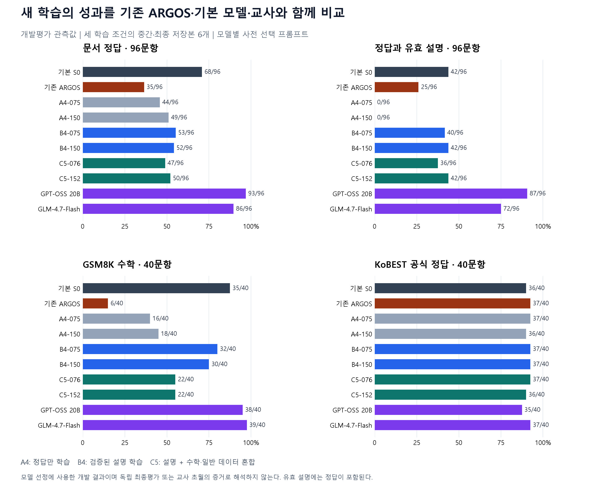

# ARGOS 제작과 개선 연구 최종보고서

마감 전 추가 학습 한 차례와 세 저장본 평가를 완료했다. 이전 ARGOS와 B4 대비 일부 회복은 있었지만 기본 모델과 두 교사를 넘는 후보는 확보하지 못했다. 선정 조건을 유지해 새 최종 시험은 실행하지 않고 모델 선정을 동결했다. 이 보고서는 DGX 계획에서 대여 24GB GPU로 바뀐 제작 이력, 기존 후속 연구, 마지막 R6 실험과 그 한계를 함께 기록한다.

기록 기준: 2026-10-27 15:01:20 KST 실험 종료 확인

[PDF 보고서](ARGOS_Improvement_Report_KO.pdf) · [다운로드용 HTML](report.html) · [공개 원자료](public-data/) · [집계 재계산 코드](code/recompute_public_report.py)

## 목차

1. [최종 결론: 일부 회복은 있었지만 기본 모델과 두 교사 초월에는 실패했다](#section-01)
2. [모든 비교 기준을 함께 놓은 개발 평가 결과](#section-02)
3. [기존 연구: 1차 후속 연구에서 확인한 결론](#section-03)
4. [기존 연구: ARGOS는 DGX 계획에서 대여 24GB 실험으로 변경됐다](#section-04)
5. [기존 연구: 교사 수집·회수·검증을 거쳐 기존 ARGOS를 만든 과정](#section-05)
6. [기존 연구: 이전 ARGOS가 얻은 강점과 잃은 능력](#section-06)
7. [기존 연구: 1차 후속 연구까지의 계획 변경 사항](#section-07)
8. [기존 연구: 자료의 출처와 새 평가의 범위를 명시한다](#section-08)
9. [기존 연구: 모델 선택과 최종 판정을 분리한다](#section-09)
10. [기존 연구: 정답·설명·주장·선호도를 구분하는 채점 기준](#section-10)
11. [기존 연구: 기본 모델의 실행 상태부터 확인했다](#section-11)
12. [기존 연구: 실제로 사용한 모델과 재현 조건](#section-12)
13. [기존 연구: 진단 후 바뀐 프로토콜과 동결 시점을 공개한다](#section-13)
14. [기존 연구: 4개 모델의 보정이 끝났고 프롬프트를 고정했다](#section-14)
15. [기존 연구: 문장을 명확히 해도 정답이 회복되지는 않았다](#section-15)
16. [기존 연구: 같은 개발 문항에서 기본 모델과 교사를 비교한다](#section-16)
17. [기존 연구: 정답·설명·유지 자료를 세 조건으로 준비했다](#section-17)
18. [기존 연구: 완료된 실제 학습을 체크포인트로 검증한다](#section-18)
19. [기존 연구: 학습 이후에도 같은 보정 규칙을 적용한다](#section-19)
20. [기존 연구: 정답 검증이 모든 설명의 충분성을 보장하지는 않았다](#section-20)
21. [기존 연구: Pro의 반론을 반영해 채점 일관성을 바로잡았다](#section-21)
22. [기존 연구: 기존 ARGOS의 회복과 교사 대비 격차를 분리해 평가](#section-22)
23. [기존 연구: 승격 기준에 따른 결정](#section-23)
24. [기존 연구: 12개 문서 유형의 전체 결과](#section-24)
25. [기존 연구: 같은 문제에서 누가 맞혔는가](#section-25)
26. [기존 연구: 회복된 후보에도 남은 오류의 실제 모습](#section-26)
27. [기존 연구: 주장 단위 검수에서는 오류 감소를 확인하지 못했다](#section-27)
28. [기존 연구: 두 AI의 별도 최초 판정과 평가자 일치도](#section-28)
29. [기존 연구: 비교 대상별 선호의 전체 분포](#section-29)
30. [기존 연구: 응답 시간은 실제 운용 관측값으로 기록한다](#section-30)
31. [기존 연구: GPU 예산·백업·종료 결과](#section-31)
32. [기존 연구: 실행량과 검수량을 실제 기록으로 구분한다](#section-32)
33. [기존 연구: 성공의 범위를 결과 전에 구분했다](#section-33)
34. [기존 연구: 관측 결과로 설명할 수 있는 범위](#section-34)
35. [기존 연구: 교사보다 나은 작은 모델이라는 가설의 문헌 근거](#section-35)
36. [기존 연구: 교사 초월을 위해 다음 실험에서 바꿀 우선순위](#section-36)
37. [기존 연구: 공개 자료로 확인할 수 있는 것](#section-37)
38. [마감 전에 한 번만 더 수행한 회복 실험](#section-38)
39. [기존 후보의 손실은 청구액과 가중점수 계산에 크게 나타났다](#section-39)
40. [기존 어댑터를 전부 적용했을 때 문서 정답이 크게 줄었다](#section-40)
41. [계산 단계를 드러내고 수학 원본 풀이를 함께 학습했다](#section-41)
42. [같은 GPU 실행에서 기본 모델 기준선을 다시 확인했다](#section-42)
43. [선정 기준과 최종 평가 방법을 후보 결과 전에 고정했다](#section-43)
44. [마지막 추가 학습은 120단계 한 번으로 끝냈다](#section-44)
45. [선정 조건을 낮추지 않고 통과 후보 0개로 종료했다](#section-45)
46. [청구액은 회복했지만 가중점수와 다른 유형의 손실은 남았다](#section-46)
47. [같은 문항의 이득과 손실을 분리하면 상쇄 관계가 드러난다](#section-47)
48. [맞은 최종 답과 틀린 설명을 분리한 실제 사례](#section-48)
49. [백업을 검증하고 GPU 종료를 확인했다](#section-49)
50. [마지막 차수에서 수행한 평가와 남겨 둔 범위를 명시한다](#section-50)
51. [연구는 부정적 결과를 포함해 종료하고 다음 가설은 분리한다](#section-51)

## 01. 최종 결론: 일부 회복은 있었지만 기본 모델과 두 교사 초월에는 실패했다

사용자가 허용한 마지막 추가 학습 R6 한 차례를 실제로 수행하고 40·80·120단계 저장본을 모두 평가했다. 문서 정답은 46·57·55/96, 수학은 34·31·34/40이었다. 같은 실행에서 다시 측정한 기본 S0의 68/96·35/40을 두 지표 모두 넘은 후보는 없었다. 미리 고정한 모든 선정 조건을 만족하는 후보가 0개이므로 승격 모델을 정하지 않고 학습과 선정을 동결했다.

R6-120은 이전 B4-075의 문서 53개·수학 32개보다 각각 2개 많았고 유효 설명은 40개에서 44개로 늘었다. 기존 ARGOS의 문서 35개·수학 6개와 비교해도 회복은 크다. 그러나 기본 모델은 문서 68개·수학 35개이며, 기존에 같은 개발셋에서 측정한 두 교사는 문서 93개·86개였다. 따라서 개선의 기준을 명시해야 한다. 기존 ARGOS의 일부 회복을 기본 모델 초월이나 교사 초월로 바꿔 표현할 수 없다.

새 합성 최종 문서 200개와 이전 미추론 공개 최종 80개는 봉인 상태로 보존했다. 통과 후보가 없으므로 새 최종 추론은 실행하지 않았다. 아래 앞부분 표는 현재까지의 결론이며, 제목에 기존 연구라고 표시한 35개 절은 원래 제작 이력과 1차 후속 연구의 기록이다. 이어지는 회복 실험 절에서 이번 방법·실측·한계를 설명한다.

| 질문 | 확인한 답 |
| --- | --- |
| 추가 학습을 실제로 했는가? | 새 기본 모델에서1회,120단계,960개 예제 |
| 이전 ARGOS보다 나아졌는가? | 일부 지표에서 회복했다. 비교 기준과 저장본을 구분해야 한다. |
| 기본 모델과 두 교사를 넘었는가? | 선정 기준 미달. 독립 최종 시험 미실행. 초월 입증 없음. |

근거: 동결한 추가 실험과 구분된 기존 실측 기록

**근거 파일**: recovery_training_summary.json, recovery_selection.json, development_metrics.csv

**해석 범위**: 개발 표본의 관측 결과. 새 독립 최종 추론은0건이며 사람 검수자는0명이다.

## 02. 모든 비교 기준을 함께 놓은 개발 평가 결과

모든 행은 같은 개발 문항의 정답 수이다. S0와 R6는 verify 프롬프트이며 기존 ARGOS와 두 교사는 이전에 선택한 direct 프롬프트를 사용했다. B4-075는 verify이다. 이번에는 교사를 다시 실행하지 않았으므로 두 교사 행은 기존 실측값으로 명시한다. 프롬프트까지 완전히 같은 비교라고 부르지 않는다.

R6-080의 유효 설명 45/96은 기본 모델 42/96보다 3개 많고, R6-120의 44/96도 2개 많다. 이는 이 개발 표본에서의 관측 우위이며 사람 평가나 독립 최종 시험의 증명이 아니다. KoBEST 공식 점수 36/40은 GPT-OSS의 35/40보다 1개 많지만 기본 S0와 같은 점수이고 GLM의 37/40보다 적다. 이 한 지표를 두 교사에 대한 일반적 초월로 해석하지 않는다. 가장 높은 문서 점수 57과 가장 높은 수학 점수 34를 서로 다른 저장본에서 골라 하나의 모델 성능으로 합치지 않는다.

| 모델 | 문서 /96 | 유효 설명 /96 | 수학 /40 | KoBEST 공식 /40 | 오류수정 /40 | 측정 구분 |
| --- | --- | --- | --- | --- | --- | --- |
| S0 | 68 | 42 | 35 | 36 | 37 | 이번 재측정 |
| 기존 ARGOS | 35 | 25 | 6 | 37 | 38 | 기존 측정 |
| B4-075 | 53 | 40 | 32 | 37 | 38 | 기존 측정 |
| R6-040 | 46 | 23 | 34 | 36 | 37 | 이번 R6 |
| R6-080 | 57 | 45 | 31 | 36 | 37 | 이번 R6 |
| R6-120 | 55 | 44 | 34 | 36 | 37 | 이번 R6 |
| GPT-OSS 20B | 93 | 87 | 38 | 35 | 36 | 기존 측정 |
| GLM 4.7 Flash | 86 | 72 | 39 | 37 | 38 | 기존 측정 |

근거: 동결한 추가 실험과 구분된 기존 실측 기록

**근거 파일**: recovery_development_evidence.jsonl, recovery_selection.json, development_metrics.csv

**해석 범위**: 개발 표본의 관측 결과. 새 독립 최종 추론은0건이며 사람 검수자는0명이다.

**유효 설명**: 요청 정답이 맞고 근거·계산·조건 적용에 중대한 오류가 없는 응답 수. 잘못된 부가 주장과 명시적 오인용도 실패로 처리한다. 단일 AI 판정이며 새로운 사람 일치도는 계산할 수 없다.

## 03. 기존 연구: 1차 후속 연구에서 확인한 결론

기존 ARGOS보다 문서 정답과 수학 최종 정답이 회복된 후보를 얻었다. 그러나 기본 모델의 두 정확도에는 못 미쳤고, 두 교사를 뛰어넘었다는 증거는 얻지 못했다. 세 가지 학습에서 저장한 여섯 후보가 모두 사전에 정한 승격 기준을 통과하지 못해 새 최종시험은 실행하지 않았다. 이 보고서는 성공을 선언하는 문서가 아니라, 실제 개선 폭과 실패 지점 및 검증 절차를 함께 기록한 완료 보고서다.

B4-075는 개발 정답 수 우선 순위로 정한 설명용 후보이다. 기존 ARGOS 어댑터에 이어 학습한 모델이 아니라, 같은 기본 모델에서 새로 시작한 어댑터다. 따라서 수치상의 회복을 관찰했다고 표현하며 동일 가중치의 복구나 개입 하나의 인과효과를 주장하지 않는다.

| 연구 질문 | 관측과 판정 |
| --- | --- |
| 기존 ARGOS보다 개선됐는가 | 문서 35→53/96, 유효 설명 25→40/96, GSM8K 6→32/40. 개발 관측값으로 부분 회복. |
| 기본 모델을 회복했는가 | 설명용 후보는 문서 53<68/96, GSM8K 32<35/40. 다른 후보의 유효 설명 최고42/96은 기본 모델과 동률. |
| 교사를 초월했는가 | 입증하지 못했다. 문서 정답은 GPT-OSS93/96·GLM86/96 대비 후보53/96이다. |
| 유리한 일부 관측값은 있는가 | KoBEST 공식 점수는 후보37/40, GPT-OSS35/40, GLM37/40이다. 작은 개발 부분집합의 차이이며 영역 우월성 증명이 아니다. |
| 최종 결정 | 승격0개, 두 번째 seed 재현0회, 봉인 최종평가0회. GPU 백업 후 종료, 관측 계정 차감 약$1.62. |

근거: 동일 개발 문항의 전체 응답 검수, 동결된 선정 파일, GPU 종료 확인

## 04. 기존 연구: ARGOS는 DGX 계획에서 대여 24GB 실험으로 변경됐다

원래 계획을 그대로 수행한 연구라고 쓰지 않는다. DGX Spark 중심 계획에서 대여 GPU의 교사 수집·본 학습으로 바뀌었고, A40 파일럿과 A5000 24GB 본 실행 및 로컬 확인 평가를 구분한다. 중단 데이터 회수와 후속 재학습도 독립된 단계로 기록한다. [이전 39쪽 보고서와 전체 이력](https://github.com/chabin0000/CoMPaSS-AI/blob/main/reports/argos-final-20261027/REPORT_KO.md)은 별도 보존한다. 아래의 과거 평가와 이번 개발평가는 문서 구성·실행 환경·목적이 다르며 공개 유지 부분집합은 재사용했다.

| 단계 | 실제 장비·계획 | 변경 사항 | 확인한 실행 증거 |
| --- | --- | --- | --- |
| DGX 계획과 소규모 파일럿 | DGX Spark 관련 계획·파일럿, 학생 RTX 5060 Ti | 초기 계획의 GPT-OSS 120B·GLM-4.5-Air와 실제 후속 교사 구성을 구분 | 2026년 8월 파일럿은 50응답·PASS 30·15학습 스텝과 새 20문항의 8→12 정답으로 기록됨. 본 클라우드 평가와 합산하지 않음 |
| 10월 클라우드 준비 | 대여 A40 48GB | 교사별 150설정 파일럿 및 학생 2스텝 시간 측정 | 준비·수집 실행이며 대규모 본 학습 결과와 구분 |
| 수집 장비 전환 | A40 → RTX A5000 24GB | 수집 도중 비용·환경에 맞춰 대여 GPU 변경; 계획서의 DGX 본 실험으로 표기하지 않음 | 중단 시 원격 7,480개를 회수. A5000은 시간당 $0.27 조건에서 동일 질문·모델 설정으로 이어감 |
| 클라우드 본 학습·평가 | 대여 RTX A5000 24GB | 서로 독립적인 학생 어댑터 10개와 기본 모델·교사를 포함한 13조건 | 340 기본·500 확장 평가에서 S5_general_control 선택. 검증 자료 14,903개와 일반 자료 500개, 1순회·963스텝·학습률 2e-4 |
| 기존 연구의 후속 확인 | 클라우드 회복 실험 및 로컬 RTX 5060 Ti 8GB | 수학 4조건·일반 1조건의 후속 후보는 승격되지 않음 | 기존 독립 평가 360고유문항·2모델·720응답은 기존 보고서 결과. 두 교사의 같은 최종 평가는 수행되지 않았음 |
| 이번 개선 연구 | 새로 대여한 RTX A5000 24GB, $10 이내 | 기본 모델·기존 ARGOS·실제 두 교사의 기준선을 새로 비교한 뒤 fresh S0 세 조건 학습 | 새 합성 문서 최종 160개와 미사용 공개 유지 80개를 별도로 봉인. 이전 보고서의 360문항 평가와 다른 실행 |

근거: 기존 공개 최종 보고서 및 이력·클라우드 전환 증거 파일을 현재 작업에서 재확인

**두 연구의 경계**: 과거 수집·학습·평가 수치를 이번 실행 수치에 더하지 않는다. 과거의 비용 한도는 실제 청구 총액이 아니며 이번 $10 허용액과 구분한다.

## 05. 기존 연구: 교사 수집·회수·검증을 거쳐 기존 ARGOS를 만든 과정

초기 48GB 수집은 시간·비용 경계에서 멈췄다. 그때 로컬 백업은 3,936개였으나 원격 성공 7,480개를 회수해 해시를 대조했다. 남은 12,500개는 대기,20개는 실패로 구분했다. 이후 A5000 24GB에서 같은 질문과 교사 설정을 이어 사용했고, 원격 성공과 로컬 회수 및 검증 통과를 별도 상태로 관리했다.

보충 수집은 144질문·두 교사에서 287응답(GPT-OSS143·GLM144), 실패 1개였다. 원래 자료를 덮어쓰지 않았고 별도 재실행 자료와 계보를 보존했다. 봉인 전 22응답 제외는 의견 문항 10개와 보류 평가 주제와 겹칠 수 있는 모호한 문항 1개, 총 11질문에 해당한다. 이를 중복 제거라고 바꾸어 부르지 않는다. 이후 검증 미통과 5,201개는 이 제외 22개와 다른 단계다.

| 데이터 단계 | 응답 수 | 상태와 분모 |
| --- | --- | --- |
| 원격 본수집 성공 | 19,923 | 생성 실패77개와 구분 |
| 로컬 본수집 회수 | 19,839 | 성공했으나 회수되지 않은84개는 학습 입력에 포함하지 않음 |
| 보충 로컬 성공 | 287 | 144질문·두 교사에서1개 생성 실패 |
| 로컬 통합 입력 | 20,126 | 19,839+287 |
| 동결 전 제외 | 22 | 의견·잠재 평가 겹침11질문; 중복 제거가 아님 |
| 원본 전체 학습 조건 | 20,104 | 고유10,133질문 |
| 검증본 | 14,903 | 고유7,974질문; 검증 실패1,228·추가 검토 보류3,973 제외 |
| 최종 선택 모델 학습 | 15,403 | 검증14,903+일반 QA500; S5_general_control |

근거: [이전 보고서의 수집 원장·제외 원장·학습 자료 분석](https://github.com/chabin0000/CoMPaSS-AI/blob/main/reports/argos-final-20261027/REPORT_KO.md)

**이전 집계 정정 유지**: 과거 대화의20,212를 현재 원장으로 재현하지 못한다. 원격 성공 합20,210과 실제 로컬 통합20,126의 차이는 미회수84개다. 20,104까지의 차이를108개 중복 제거로 설명하지 않는다.

## 06. 기존 연구: 이전 ARGOS가 얻은 강점과 잃은 능력

이전 본 실험에서는 기본 모델과 두 교사를 포함한 13개 조건, 독립적으로 학습한 학생 10개를 비교했다. 최종 선택된 S5_general_control은 검증 자료 14,903개와 일반 자료 500개, 총 15,403개를 1회 순회해 963단계를 학습했다. 학습률 2×10⁻⁴, LoRA r16·alpha32·dropout0.05, NF4·BF16 설정이었다. 열 가지 조건은 하나의 모델에 순서대로 누적 학습한 열 단계가 아니다.

이후 수학 4개·일반 1개 회복 후보를 추가로 시험했으나 승격하지 않았다. 이전 확인 평가에서는 새 비공개 240문항과 공개 부분집합 120문항, 고유 360문항을 기본 모델·기존 ARGOS에 각각 실행해 720응답을 얻었다. 아래는 그 과거 평가이며 현재 개발 176문항과 합치지 않는다. 당시 두 교사의 동일 최종평가는 수행하지 않았다.

| 과거 평가 영역 | 문항 | 기본 모델 정답 | 기존 ARGOS 정답 |
| --- | --- | --- | --- |
| 비공개 수학 | 80 | 68 | 37 |
| 출처 기반 사실 | 60 | 53 | 60 |
| 전제 점검 | 60 | 55 | 50 |
| 형식 준수 | 40 | 3 | 27 |
| KLUE 부분집합 | 40 | 33 | 36 |
| KoBEST 부분집합 | 40 | 36 | 37 |
| GSM8K 부분집합 | 40 | 37 | 6 |

근거: 이전 공개 최종보고서와 저장된 모델 선정·학습·평가 기록

**해석**: 출처 사실과 형식 준수의 이득, 수학 저하가 함께 관찰됐다. 공개 GSM8K 문항과 프롬프트는 이전 것을 재사용했으나 런타임·장치 등 실행 조건이 다르다. 현재 기본 모델35/40과 과거37/40 차이를 가중치 변화의 효과로 해석하지 않는다.

## 07. 기존 연구: 1차 후속 연구까지의 계획 변경 사항

계획서를 연구 수행의 역사적 출발점으로 보존하면서 실제 실행 기록을 우선한다. 아래 변경과 미실행은 숨기지 않으며, 보고서의 완료와 모든 계획 목표의 달성을 구분한다.

| 원래 목표·전제 | 실제 수행·미수행 |
| --- | --- |
| DGX 및 대형 교사 중심 계획 | DGX 파일럿 뒤 대여 A40·A5000으로 변경. 실제 교사는 GPT-OSS20B와 GLM-4.7-Flash, 본 개선은24GB A5000. |
| 교사·외부 검수자2명 | 사용자 요청에 따라 AI 검수. 주 검수 Codex와 기존 프로젝트 Pro의 별도 선호 판정. 실제 사람0명. |
| 새 비공개 최종200문항 이상 | 이번 봉인 구성은 비공개 합성160+공개 미사용80=240. 비공개200 목표는 미충족. 모든 후보의 사전 요건 실패로 최종 실행0회. |
| 원래 평가 범위 | 과거 KMMLU100 및 KLUE·KoBEST·GSM8K 각40 부분집합. 이번에는 새 문서96+GSM8K40+KoBEST40 개발 평가. MMLU-Pro·GPQA·CMMLU 전체는 미실행. |
| 한 번의 선정·최종 보고 | 과거 본 학습 뒤 수학4+일반1 후보와 이번3조건·6저장본의 후속 연구를 추가. 모두 시점·문항·목적을 구분. |
| 교사 초월 목표 | 이번 조건에서 입증 실패. 부분 회복과 잔존 오류를 부정적 결과로 보고하며 기준을 낮춰 성공으로 바꾸지 않음. |

근거: 계획서, 과거 기록, 이번 사전 설계 및 실제 실행

## 08. 기존 연구: 자료의 출처와 새 평가의 범위를 명시한다

일반 유지 자료는 [SQuAD](https://huggingface.co/datasets/rajpurkar/squad) train의 기존 AI 검수 계보에서 가져왔다. 리비전 7b6d24c440a36b6815f21b70d25016731768db1f, 원 기사 URL·자료 라이선스 메타데이터·원문 해시를 보존했다. 실제 선택된 91개 고유 문항의 출처를 공개하며 원문 지문 전체는 재배포하지 않는다. 유지 개발평가는 [GSM8K](https://huggingface.co/datasets/openai/gsm8k)와 [KoBEST](https://huggingface.co/datasets/skt/kobest_v1)의 이전 공개 부분집합과 프롬프트를 재사용한다. 고정 리비전·분할 파일·개발 인덱스·캐시 해시는 공개 원자료에 기록했다.

이번 개선은 검증한 정답·설명을 학습하는 지도 미세조정이다. 교사의 응답만을 복사하는 순수 증류나 별도 과정 보상 모델의 학습은 아니다. 학습 600개와 평가 자료의 정확 정규화 중복은 점검했지만 의미상 유사성이나 사전학습 오염의 부재를 보장하지 않는다.

| 구성 | 출처 | 규모 | 해석 범위 |
| --- | --- | --- | --- |
| 새 문서 학습 | AI 작성 가상 문서와 별도 산술·조건 재계산 | 600 고유 문항 | 정의한 12계열·문체·연산이 보정 및 개발과 겹침 |
| 수학 유지 자료 | 기존 혼합 원본에서 computed_math만 추출, 유리수 두 방식으로 재검증 | 240개 풀 중 C5에 90개 | 범용 수학 분포를 대표하는 자료가 아님 |
| 일반 유지 자료 | 이전 AI 검수 SQuAD train의 정답 구간과 근거 문장 | 91 고유 문항·순회당 96행 | 공개 자료의 기존 사람 주석은 이번 연구의 사람 검수가 아님 |
| 공개 유지 개발 | 기존에 노출된 GSM8K·KoBEST-BoolQ 문항 | 각 40개 | 모델 선택용이며 독립 최종 평가로 재명명하지 않음 |
| 새 최종 묶음 | 새 합성 문서 160개 + 기존 실행에서 미사용 공개 문항 80개 | 총 240개 | 240개 전체가 새 비공개 문항인 것은 아님; 200개 이상의 새 비공개 문항 목표와도 다름 |

근거: 봉인 해시·자료 준비 영수증·원본 출처 메타데이터

**중복 점검의 실제 범위**: 학습 질문과 보정·개발·최종 질문의 정규화된 완전 일치는 0건이었다. 이 검사는 근접 중복, 공통 템플릿, 사전학습 오염을 배제하지 않는다. 최종 질문과 키는 처음 GPU 전송에서 제외했다.

## 09. 기존 연구: 모델 선택과 최종 판정을 분리한다

보정 48문항에서 각 모델에 동일한 두 프롬프트를 적용하고 정답 수 우선·동률 direct 규칙으로 선택했다. 개발 96개 문서와 공개 유지 80문항에서 후보를 비교했다. 훈련 전에 새 최종 자료를 검증·봉인하고 조건을 동결했으나, 모든 후보가 개발 승격 기준에 미달해 최종시험을 실행하지 않았다. 새 최종 계획은 합성 비공개 160문항과 공개 미사용 부분집합 80문항으로 총 240문항이다. 240개 모두 비공개 신문항이 아니며, 비공개 200문항 이상이라는 원래 목표를 충족했다고 주장하지 않는다. 합성 160개는 기존 12유형 120개와 새 조합 4유형 40개로 구성했다. 최종 자료는 생성·검증 과정에서 정답을 다뤘지만 봉인 후 모델 선정에 사용하지 않았고 최종 추론도 0회다. 봉인은 로컬 SHA-256과 시점 기록으로 구현했으며 외부 기관의 독립 타임스탬프나 사람 검증이 아니다. 종료 후 원본 12개 파일의 해시 일치를 다시 확인했다. 사람 검수자는 0명이다.

| 단계 | 문항 수 | 범위 |
| --- | --- | --- |
| 공통 보정 | 48 | 두 프롬프트를 기본 모델·기존 ARGOS·두 교사에 적용; 선택용으로만 사용 |
| 개발 — 주 과제 | 96 | 모델 선택용; 최종 성능 주장에 재사용하지 않음 |
| 개발 — 유지 진단 | 80 | 노출된 공개 수학 40 + 일반 언어 40 |
| 최종 — 주 과제 | 160 | 봉인: 기존 연산군의 새 문서 120 + 새 조합 40 |
| 최종 — 유지 확인 | 80 | 봉인: 미사용 공개 문항, 사전학습 오염 여부 불명 |

근거: GPU 시작 전 생성·검증·봉인한 실험 설계

**설계와 변경 기록**: 첫 GPU 진단 이후 답 우선 형식을 풀이 후 최종 답 형식으로 수정했다. 공통 보정과 기준선 응답 704개 검수를 완료한 뒤 세 조건의 학습 설정을 동결하여 실행했다. 최종 평가는 개발 승격과 두 시드 확인을 통과한 경우에만 개봉한다.

## 10. 기존 연구: 정답·설명·주장·선호도를 구분하는 채점 기준

하나의 종합점수로 서로 다른 과제를 합치지 않았다. 문서 정답을 맞혔다고 모든 설명이 옳다고 판단하지 않으며, 자연스러운 한국어를 썼다고 사실성이나 교사 대비 능력이 높다고 판단하지 않는다. 모델 출력의 실제 최종 답과 설명을 보존해 외부에서 판정을 다시 검토할 수 있게 했다.

| 지표 | 정의 |
| --- | --- |
| 문서 정답 /96 | 문항의 요청에 맞는 최종 답의 의미적 정오. 형식 차이를 허용하되 오답·미완료는 실패. |
| 유효 설명 /96 | 정답이며 실제 근거·계산·조건 적용이 타당해야 한다. 정답 반복만 있거나 명시적 거짓 보조 주장이 있으면 실패. 짧은 정확한 수식 또는 조건과 필터 결과는 허용. |
| GSM8K /40 | 공식 공개 시험의 고정 부분집합 최종 수치 정답. 중간 풀이의 정당성을 별도로 채점하지 않았다. |
| KoBEST 공식·수정 /40 | 공식 정답을 주 지표로 보존하고, 1개 정답표 오류에 대한 동일 수정 키를 모든 모델에 병행 적용. |
| 주장 모순율 | 문서·정답 근거와 모순되는 원자적 주장 수 ÷ 검수한 전체 주장 수. 판단 불가는 별도이며 함께 합친 비지지율도 공개. |
| 쌍대 종합·자연스러움 | 정답→유효 근거→명료·간결함의 종합 선호와, 한국어의 읽기 쉬움·표현 연결을 따로 평가. A/B/동률 허용. |
| 응답 완료 | 런타임 종료·응답 유효성 기준. 길이 제한과 미완료를 분모에서 빼지 않는다. |

근거: 학습 전 합의한 기준과 버전이 보존된 실제 판정

**정정**: 유효 설명 기준의 불일치5건은 원판정을 보존하고 정정 목록을 적용했다. 새 기준으로 결과를 유리하게 바꾼 별도 실험으로 취급하지 않는다.

## 11. 기존 연구: 기본 모델의 실행 상태부터 확인했다

기존에 노출된 수학 16문항을 동일한 프롬프트와 생성 조건으로 재실행했다. 이전과 현재 모두 14개를 맞혔지만, 서로 다른 두 문항에서 승패가 바뀌었다. 별도 쉬운 문제 4개는 모두 정답이었으며, 같은 가중치에서 순수 기본 모델과 어댑터를 비활성화한 실행의 출력도 이 4개에 한해 일치했다. 이 작은 통제는 광범위한 런타임 붕괴 가능성을 낮추지만 전체 동등성을 증명하지 않는다.

| 비교 | 의미 정답 | 문항 수 |
| --- | --- | --- |
| 이전 S0 | 14 | 16 |
| 현재 S0 | 14 | 16 |

근거: 실제 GPU 응답과 단일 AI 의미 검수: 노출된 수학 진단 16문항

**수학 진단 재현**: 기존 16문항·공식 템플릿·seed 20261026·512토큰·180초로 현재 S0를 실행하고 이전 저장 응답과 비교했다. 두 응답이 달라진 항목이 있어 전체 런타임 동등성의 증명은 아니다.

**의미 정답**: 최종 결론이 기준 답과 의미상 일치한 문항 수. 사람 검수자 0명; 저자인 Codex의 단일 AI 검수.

## 12. 기존 연구: 실제로 사용한 모델과 재현 조건

본 개선 실험의 모델 크기와 양자화, 추론 방식은 아래와 같다. GPU 24GB에서 실행됐다는 사실은 원래 계획의 대형 교사 모델을 같은 조건으로 실행했다는 뜻이 아니다. 세 학습 조건은 각각 독립된 시작이며, 6개 체크포인트는 독립된 여섯 번의 학습이 아니라 세 학습의 중간·최종 저장본이다. 학습 단계·손실·모델 파일 검증과 평가 정확도를 구별한다.

| 항목 | 고정·관측 값 | 해석과 재현 범위 |
| --- | --- | --- |
| 기본·학생 모델 | LGAI-EXAONE/EXAONE-3.5-7.8B-Instruct | 고정 리비전 553ea250b9a5; 기존 ARGOS를 이어 학습하지 않고 세 조건 모두 S0에서 새로 시작 |
| 교사 1 | gpt-oss-20b, Q4_K_M GGUF | llama.cpp; reasoning=medium. 최초 계획의 120B 모델과 구분 |
| 교사 2 | GLM-4.7-Flash, Q4_K_M GGUF | llama.cpp; thinking 활성. 최초 계획의 GLM-4.5-Air와 구분 |
| 현재 실행 장치 | 임대한 RTX A5000 24GB | 관측 VRAM 24,564 MiB. 학생은 NF4 double quantization과 BF16 계산; 비양자화 대체 실행 없음 |
| 공식 추론 조건 | greedy; 출력 상한 8,192 토큰 | 기존 4,096 토큰 보정에서 길이 종료가 확인되어 개발평가 전에 한 번 확장. GLM의 미완료 출력은 오답으로 집계 |
| 프롬프트 정책 | 모델별 48문항 × 2개 후보 | 정답 수 우선, 동률이면 direct. 각 모델이 고른 프롬프트를 개발평가 전에 고정; 모든 모델에 동일 문구를 쓴 인과 비교가 아님 |
| LoRA 구성 | r16 / alpha32 / dropout0.05 | q_proj, k_proj, v_proj, out_proj; 학습 가능 파라미터 13,631,488개 |
| 최적화 | AdamW; LR 0.00005; 2 epochs | 배치 1 × 누적 8, linear schedule, warmup 3%, gradient clipping 1.0, weight decay 0 |
| 입력·정답 처리 | 최대 1,536 토큰; 잘림 금지 | 프롬프트 손실 마스킹, EOS 감독. 학습 전 실제 토크나이저로 전체 길이 확인 |
| 공통 난수 조건 | 주 실행 20261027 | 통과 후보만 동일 전체 학습 일정으로 두 번째 seed 20261028 확인. 더 잘 나온 seed로 주 모델을 바꾸지 않음 |
| 학생 라이브러리 | Transformers 5.1.0 / PEFT 0.19.1 | bitsandbytes 0.50.2; Accelerate 1.15.0. 코드·토크나이저·데이터·체크포인트 해시를 별도 증거에 기록 |
| 승격 조건의 함의 | 유효 설명 ≥87이면 정답도 ≥87 | 유효 설명은 정답을 포함하는 지표이므로 73정답 게이트만 통과해서는 승격할 수 없다. 수치 기준을 결과에 맞춰 낮추지 않음 |

근거: 동결 학습 설정, 실제 완료 체크포인트, 런타임 검증과 추론 작업 기록

**실행 검증의 범위**: 6개 체크포인트의 유한한 텐서와 실제 Trainer 단계, 응답 수, 백업 해시를 확인했다. 4문항의 런타임 일치 확인이나 작은 sentinel 점수는 전체 모델의 동등성 증명이 아니다. 첫 토큰 시간은 reasoning 또는 final 중 먼저 나온 토큰이며 사용자에게 보이는 최종 답의 첫 토큰 시간과 같지 않다.

## 13. 기존 연구: 진단 후 바뀐 프로토콜과 동결 시점을 공개한다

이번 절차를 처음부터 끝까지 전혀 수정하지 않은 사전등록 실험으로 제시하지 않는다. 초기에 답을 먼저 쓰게 한 보정에서 최종 결론 모순과 자동 형식 채점의 불일치를 관찰했다. Pro와 검토한 뒤 런타임 통제를 확인하고, 모든 모델에 공통으로 근거 먼저·최종 정답 마지막 방식의 두 프롬프트를 적용했다. 이전 답 우선 출력은 진단 기록으로 보존했다. 개발 질문과 정답은 바꾸지 않았다.

학습 구성과 수치 승격 기준은 704개 기준선 개발 응답을 검수한 뒤, 실제 학습을 시작하기 전에 고정했다. 후보별 프롬프트는 별도 보정 48문항에서만 골랐으며 후보 개발 결과를 보고 바꾸지 않았다. 최종 판정 규칙은 봉인 최종결과를 보기 전에 정했다.

| 변경 | 시점 | 적용 범위 |
| --- | --- | --- |
| 답 우선→근거 우선 | 초기 보정 진단 뒤, 교사 공식 보정·훈련 전 | 모든 모델에 같은 두 후보 프롬프트. 초기 자료는 진단용으로만 사용. |
| 4,096→8,192 생성 상한 | 길이 제한 비율을 확인한 뒤, 개발 평가 전 | 사전 허용한 한 번의 공통 확장. 미완료는 분모에 유지. |
| 보정 전수 AI 확인 | 자동 비일치뿐 아니라 일치 출력도 읽도록 보강 | 정답 수치가 같아도 잘못된 설명이 있는지 별도 확인. |
| 유효 설명5건 정정 | 일부 후보 보정 후, 후보 개발 시작 전 | 저장된 v3 기준의 불일치를 같은 유형48응답에서 점검. 원판정 보존·수치 승격 기준 유지. |

근거: calibration_order_amendment_v2, review_and_logging_amendment 및 버전별 판정 원장

## 14. 기존 연구: 4개 모델의 보정이 끝났고 프롬프트를 고정했다

48개 고유 문항에 동일한 두 프롬프트를 적용한 384개 응답을 검수했다. 이 중 192개는 이전 실행과 응답·문항이 정확히 같은 기존 판정을 재사용했고 192개는 새로 읽었다. 공통 8192토큰 조건에서 S0는 verify36/48, 기존 ARGOS는 direct17/48, GPT-OSS는 direct47/48, GLM은 direct43/48을 맞혔다. 동률이면 direct를 선택하는 규칙을 따랐다. GPT-OSS2/96,GLM7/96의 길이 제한 실패는 분모에 남겼다.4096→8192확장은 사전 기준에 따른 한 번의 공통 확장이며 추가 확장은 없다. 이는 프롬프트 선택용 보정 결과로 독립 최종 성능이 아니다. 출처 누락과 명시적인 오귀속을 구분하는 기준을 Pro와 명확히 하고 정오표를 보존했다. 사람 검수자는 0명이다.

| 모델 | 프롬프트 | 의미 정답 | 응답 수 | 유효한 설명 | 선정 상태 |
| --- | --- | --- | --- | --- | --- |
| S0 | direct | 26 | 48 | 22 | 미선정 |
| S0 | verify | 36 | 48 | 27 | 선정 |
| gpt_oss | direct | 47 | 48 | 43 | 선정 |
| gpt_oss | verify | 47 | 48 | 46 | 미선정 |
| glm | direct | 43 | 48 | 40 | 선정 |
| glm | verify | 39 | 48 | 31 | 미선정 |
| ARGOS_old | direct | 17 | 48 | 12 | 선정 |
| ARGOS_old | verify | 11 | 48 | 1 | 미선정 |

근거: 4개 모델384개 응답의 AI 의미 검수와 프롬프트 고정

**마스킹된 응답 검수**: 실제 저장된 응답과 검증된 정답·근거를 대조했다. 모델 표기는 제거했으나 검수자는 문항 저자인 Codex이며 독립 사람 검수가 아니다. 보정 문항으로 프롬프트만 선택한다.

## 15. 기존 연구: 문장을 명확히 해도 정답이 회복되지는 않았다

쿠폰 잔여량이 0인 보정 문항 1개의 비율 문장만 바꿔 모델별 1회 진단했다. 네 모델 모두 의도한 정답 0을 내지 못했다. GPT-OSS는 길이 제한 종료에서 정상 종료로 바뀌었으나 72를 답했다. 문구가 동작에 영향을 주었다는 사례이며, 문구만이 오류 원인이라는 증거는 아니다. 원래 평가와 봉인을 유지하고 학습용 50문항만 일괄 정리했다. 이 진단 점수로 주평가를 대체하지 않는다.

| 모델 | 원본 종료 | 명확화 후 응답 | 정답성 |
| --- | --- | --- | --- |
| S0 | eos | 문서 [document2]에 따르면, 사용자는 총 40점을 보유하고 있으며, 쿠폰 1장당 물품 12개로 교환 가능하다는 정보가 있습니다. 하지만 포인트를 쿠폰으로 교환하는 구체적인 비율이나 남은 포인트가 정확히 몇 개인지에 대한 정보는 문서 [calibration-exchange-002]의 [문서1]과 [문서2]에서 명확하게 제시되어 있지 않습니다. 포인트를 쿠폰으로 완전히 교환했다는 가정 하에 계산을 시도할 수 있지만, 정확한 교환 비율이나 남은 포인트의 수 없이는 정확한 물품 수량을 계산할 수 없습니다.  정답: 확인 불가 | 오답 |
| ARGOS_old | eos | 40/6 * 12 = 80 | 오답 |
| gpt_oss | length | 문서1에 따르면 6점마다 쿠폰 1장을 교환할 수 있다.   문서2에 따르면 현재 40점이므로 40 ÷ 6 = 6장(남은 4점은 버리지 않는다).   쿠폰 1장당 물품 12개이므로 6 × 12 = 72개.    정답: 72 | 오답 |
| glm | stop | 문서2에 따르면 40점을 6점당 1장의 비율로 교환하면 6장의 쿠폰을 얻을 수 있고, 남은 4점은 버려집니다. 문서2에 따르면 쿠폰 1장당 12개의 물품을 교환할 수 있으므로, 6장을 사용하면 72개의 물품을 얻을 수 있습니다.  정답: 72 | 오답 |

근거: 동일한 보정1문항의 문구 대조, 실제 모델4회 실행

**일회 진단과 원점수 보존**: 고정한1문항과 동일한direct프롬프트,8192토큰으로 모델별1회만 실행. 정답0대비 네 응답 모두 오답. 기존 기본 평가 점수에 대체 반영하지 않음.

## 16. 기존 연구: 같은 개발 문항에서 기본 모델과 교사를 비교한다

모델별 보정 결과로 선택한 프롬프트를 고정해 실행했다. 이 표는 모델 선택용 개발 결과이며 최종 일반화 성능의 증명이 아니다. 공식 KoBEST의 배우와 배역 관계 1문항에서 정답 오류를 확인하여, 원래 점수를 유지하면서 같은 수정 키를 모든 모델에 적용한 민감도 결과를 따로 표시한다. 수정 점수도 유지 조건을 만족해야 승격할 수 있으며 공식 점수의 실패를 구제하지 않는다.

| 모델 | 문서 정답 | 유효 설명 | GSM8K 공식 | KoBEST 공식 | KoBEST 수정 민감도 |
| --- | --- | --- | --- | --- | --- |
| S0 | 68/96 | 42/96 | 35/40 | 36/40 | 37/40 |
| ARGOS_old | 35/96 | 25/96 | 6/40 | 37/40 | 38/40 |
| gpt_oss | 93/96 | 87/96 | 38/40 | 35/40 | 36/40 |
| glm | 86/96 | 72/96 | 39/40 | 37/40 | 38/40 |

근거: 실제 GPU 응답 전체를 읽고 기록한 개발 기준선; 완료·검수된 모델만 표시

**개발 결과와 지표의 분리**: 새 문서96개는 최종 결론과 유효 설명을 따로 평가했다. 공개 유지 문항80개는 공식 정답 일치도를 기록했다. 유효 설명의 분모는 문서 전체96개이며, 공개 유지 과제의 설명 품질은 평가하지 않았다.

## 17. 기존 연구: 정답·설명·유지 자료를 세 조건으로 준비했다

A4는 같은 600문항의 정답만, B4는 검증된 설명과 정답을 학습한다. C5는 문서 422개·실제 수학 90개·일반 독해 91개의 고유 문항에 일반 문항 5회 반복을 더했다. 반복을 포함한 행 비율은 69.41%·14.80%·15.79%, 감독 토큰 비율은 69.70%·14.94%·15.37%다. B4와 C5의 감독 토큰 수 차이는 +0.515%지만 질문 노출량과 연산량은 같지 않다. A4와 B4는 감독 토큰 수가 같지 않으므로 설명만의 순수 인과효과로 해석하지 않는다. 기준선 704개 응답 검수 후 실제 학습 설정을 동결했다. 각 조건은 두 번 순회하며 중간·종료 체크포인트만 평가한다.

학습 전 자료 정체성 점검에서 이전 유지 풀 240개 중 237개만 수학이고 3개는 다른 유형임을 발견했다. computed_math 유형으로 다시 추출하고 유리수 두 방식으로 정답을 재계산한 240개 풀에서 90개를 선택한 C5로 수정했다. 이전 C4는 학습하지 않았다. 버전 번호를 실제 학습 횟수로 세지 않으며 A4·B4·C5만 실행한 세 조건이다.

| 조건 | 고유 문항 | 순회당 행 | 순회당 감독 토큰 | 예정 스텝 | 최대 입력+출력 토큰 |
| --- | --- | --- | --- | --- | --- |
| A4 | 600 | 600 | 3750 | 150 | 231 |
| B4 | 600 | 600 | 29716 | 150 | 306 |
| C5 | 603 | 608 | 29869 | 152 | 681 |

근거: CPU에서 완성·검증한 학습 자료; 실행 결과와 구분

**오류 수정 이력**: 기존 혼합 회복 파일을 길이만으로 걸렀을 때 수학240개 중3개가 비수학이었다. 사용하지 않은C4를 보존하고, computed_math 조건과 독립 재계산을 통과한240개 풀에서C5의 수학90개를 다시 구성했다. 이 준비 오류는 과거 ARGOS 성능 저하 원인의 증거가 아니다.

## 18. 기존 연구: 완료된 실제 학습을 체크포인트로 검증한다

로컬에 회수하고 검증을 마친 조건만 표시한다. 세 조건 모두 고정한 기본 모델에서 독립적으로 시작한다. 누적 학습한 하나의 모델을 조건별로 나눈 것이 아니다. 경과 시간은 모델 로딩 등을 포함하며 순수 학습 속도나 연산량을 비교하는 지표가 아니다. 별도 추론 실행에서 저장 어댑터를 다시 불러와 평가해야 성능 결과가 된다.

| 조건 | 실제 스텝 | 실제 순회 | 실행 경과 초 | 최대 PyTorch 할당 GiB | 가중치 검증 | 저장 스텝 |
| --- | --- | --- | --- | --- | --- | --- |
| A4 | 150 | 2.0 | 610.5 | 7.86 | 확인 | 75, 150 |
| B4 | 150 | 2.0 | 463.0 | 7.98 | 확인 | 75, 150 |
| C5 | 152 | 2.0 | 450.8 | 8.6 | 확인 | 76, 152 |

근거: 해시 검증한 GPU 백업의 Trainer 기록과 실제 체크포인트

**실행 증거의 범위**: 학습 스텝·두 번 순회·손실 및 기울기의 유한성·저장 가중치의 유한성과 LoRA B 갱신을 확인했다. 할당 메모리는 PyTorch 최대 할당량이며 장치 전체 VRAM 사용량이 아니다. 손실 감소와 가중치 검증만으로 정답률 개선을 주장하지 않는다.

## 19. 기존 연구: 학습 이후에도 같은 보정 규칙을 적용한다

A4는 정답만, B4는 정답과 근거, C5는 문서·수학·일반 자료를 섞어 학습한 조건이다. 숫자는 저장 가중치를 다시 불러와 생성한 응답의 검수 결과다. 출력 형식이 익숙해지거나 학습 손실이 낮아졌다는 사실과 별도로, 최종 결론과 설명의 타당성을 각각 확인한다. 여섯 지점 모두 완료됐으며 총 576개 보정 응답을 검수했다. 동일한 질문·출력·조건이 확인된 162건은 기존 판정을 재사용했다.

| 체크포인트 | direct 정답 | direct 유효 설명 | verify 정답 | verify 유효 설명 |
| --- | --- | --- | --- | --- |
| A4-075 | 22/48 | 0/48 | 22/48 | 0/48 |
| A4-150 | 24/48 | 0/48 | 24/48 | 0/48 |
| B4-075 | 21/48 | 19/48 | 24/48 | 20/48 |
| B4-150 | 29/48 | 27/48 | 27/48 | 22/48 |
| C5-076 | 26/48 | 22/48 | 24/48 | 21/48 |
| C5-152 | 28/48 | 24/48 | 18/48 | 14/48 |

근거: 학습 후 체크포인트별 실제 보정 응답 96개가 모두 검수된 경우만 표시

**보정 결과의 용도**: 각 지점에 동일한 48문항과 두 프롬프트를 적용한다. 정답률로 프롬프트를 선택하고 동률이면 direct를 택한다. 개발 승격과 최종 일반화의 증거로 대체하지 않는다. 완전히 같은 질문·정답·근거·응답·완료 상태에는 기존 AI 판정을 재사용하고 출처 해시를 보존한다.

## 20. 기존 연구: 정답 검증이 모든 설명의 충분성을 보장하지는 않았다

학습 목표 일부는 조건을 나열하고 충족자가 없다고만 쓴다. 예를 들어 경력 4년 조건에서 네 명은 경력이 부족하고 나머지 한 명은 자격증이 없다는 배제 사실이 목표 문장에는 생략됐다. 이는 수치 정답 오류가 아니라 설명 충분성의 정의와 검수 일관성에 관한 한계다. 저장된 기존 기준은 간결한 핵심 조건과 필터 결과로 통과할 수 있다고 했으나 일부 AI 판정은 더 엄격하게 해석했다. Pro가 이 차이를 지적했고 원문과 이전 판정 시점을 대조했다. 정답·규칙·계산 또는 필터 결과를 점검한 정형 설명이며, 모든 목표의 논증 충분성을 전수 보장한 것은 아니라고 명시한다. 이 작은 부분집합만으로 더 넓은 계산 실패의 원인을 입증할 수 없다. 단계별 계산과 배제 사실을 보강하는 후속 실험은 이번에 실행한 결과와 구분한다.

| 조건 | 전체 고유 문항 | 교집합 문항 | 배제 사실 생략 목표 |
| --- | --- | --- | --- |
| B4 | 600 | 50 | 14 |
| C5 | 603 | 39 | 10 |

근거: B4 보정 응답 검수 후 원래 학습 파일을 읽은 좁은 사후 진단

**정확성과 충분성의 차이**: 규칙·정답 0은 맞지만 대상자별 배제 근거를 쓰지 않은 충족자 없음 패턴만 센 것이다. 전체 설명 품질 감사나 사람 검수를 대신하지 않는다. 학습 자료와 승격 숫자 기준은 유지한다. 검수의 일관성 교정은 원판정을 보존하는 별도 버전 기록으로 구분한다.

## 21. 기존 연구: Pro의 반론을 반영해 채점 일관성을 바로잡았다

일부 후보 보정 결과를 본 뒤, 후보 개발평가를 시작하기 전에 수행한 정정이다. 기존 합의문은 정확한 핵심 조건과 필터 결과를 제시한 짧은 설명을 허용했고, 0명일 때만 개별 배제 사실을 추가로 요구하지 않았다. 초기 AI 판정 일부가 이 기준보다 엄격하게 적용된 점을 Pro가 지적했다. 모든 해당 모델의 0명 교집합 응답 48개를 통과·실패 여부와 무관하게 다시 읽어, 거짓 주장 없이 세 조건과 올바른 결과를 쓴 5건만 정정했다. 조건 누락·거짓 사실·틀린 결과·정답만 있는 출력은 여전히 실패한다. 개발 선정에는 정정 후 점수를 사용한다. 정정 전 값은 불일치가 있었던 원판정 집계이며, 일관된 별도 엄격 기준의 실험 결과가 아니다. 실제 사람 검수나 독립 평가로 표현하지 않는다.

| 단계 | 모델 | 프롬프트 | 문항 수 | 원판정 유효 설명 | 정정 후 유효 설명 |
| --- | --- | --- | --- | --- | --- |
| development | glm | direct | 96 | 71 | 72 |
| candidate_calibration | B4-150 | direct | 48 | 26 | 27 |
| candidate_calibration | B4-150 | verify | 48 | 21 | 22 |
| candidate_calibration | C5-076 | direct | 48 | 21 | 22 |
| candidate_calibration | C5-076 | verify | 48 | 20 | 21 |

근거: 원래 루브릭 v3, 원판정, 48개 관련 응답 재검토와 버전별 정정 5건

**원본과 계산 재현**: 원판정 파일을 보존하고 응답·원판정·정정 기록의 해시를 확인한 뒤 집계에 정정을 적용한다. 완전히 같은 검수 내용의 재사용에도 같은 정정을 적용한다. 정답 판정은 한 건도 바꾸지 않았고 GPT의 유효 설명 87/96 및 다섯 숫자 게이트도 유지했다.

## 22. 기존 연구: 기존 ARGOS의 회복과 교사 대비 격차를 분리해 평가

A4는 정답만, B4는 같은 600문항에 검증된 설명을 추가해 학습했다. C5는 설명 데이터에 수학·일반 데이터를 섞었다. 각 행은 동일한 개발 문항에 대한 관측값이며 모델별 문서 프롬프트는 사전에 선택됐다. 기존 ARGOS보다 나아졌다는 사실과 기본 모델 또는 교사보다 우수하다는 주장은 구분한다. KoBEST 수정 열은 사전에 고정한 1개 정답표 오류의 민감도 결과이고 공식 열을 대체하지 않는다.

| 모델·저장본 | 문서 정답 | 유효 설명 | GSM8K | KoBEST 공식 | KoBEST 수정 |
| --- | --- | --- | --- | --- | --- |
| 기본 S0 | 68/96 | 42/96 | 35/40 | 36/40 | 37/40 |
| 기존 ARGOS | 35/96 | 25/96 | 6/40 | 37/40 | 38/40 |
| A4-075 | 44/96 | 0/96 | 16/40 | 37/40 | 38/40 |
| A4-150 | 49/96 | 0/96 | 18/40 | 36/40 | 37/40 |
| B4-075 | 53/96 | 40/96 | 32/40 | 37/40 | 38/40 |
| B4-150 | 52/96 | 42/96 | 30/40 | 37/40 | 38/40 |
| C5-076 | 47/96 | 36/96 | 22/40 | 37/40 | 38/40 |
| C5-152 | 50/96 | 42/96 | 22/40 | 36/40 | 37/40 |
| GPT-OSS 20B | 93/96 | 87/96 | 38/40 | 35/40 | 36/40 |
| GLM-4.7-Flash | 86/96 | 72/96 | 39/40 | 37/40 | 38/40 |

근거: 10개 모델·체크포인트의 개발 응답 1,760개; 원판정과 v3 정정 적용 후 집계

**범위와 분모**: 문서 정답과 유효 설명은 각각 96문항, GSM8K·KoBEST는 각각 공식 테스트셋의 40문항 부분집합이다. 각 부분집합의 고정 관측값을 보여 주며 모집단 신뢰구간을 표시하지 않는다. 문서 검수는 정답인 출력도 전부 확인했다. 완전히 동일한 검수 내용만 이전 판정을 재사용했다.

**비교 해석**: 6개 저장본과 프롬프트를 선택하는 데 사용한 자료다. 독립 최종평가와 유의한 교사 초월을 입증하지 않는다. 공개 유지평가는 최종 답을 채점했으며 중간 풀이 타당성은 채점하지 않았다. 올바른 최종 수치가 잘못된 중간 풀이와 함께 나오는 사례도 있다.

**재현**: 공개 집계 JSON의 SHA-256: 1c7f8b9bab0e9a9f3a9800e80c9953f3c8c622cff0bcc8417b7c9bea869caa72

## 23. 기존 연구: 승격 기준에 따른 결정

여섯 저장본 모두 승격 기준을 충족하지 못했다. 이후 두 번째 seed 학습과 새 최종평가는 조건부 실행 요건을 충족하지 않아 진행하지 않는다. B4-075는 오류 분석을 위해 순위 규칙으로 정한 설명용 후보이며 배포·승격 모델이 아니다. 최종 문항을 열어 더 좋은 성적이 나오는지 확인하거나 개발 기준을 낮춰 결과를 구제하지 않는다.

| 후보 | 문서 ≥73 | 설명 ≥87 | 수학 ≥33 | 공식 Ko ≥34 | 수정 Ko ≥35 | 결정 |
| --- | --- | --- | --- | --- | --- | --- |
| A4-075 | 44 · 미달 | 0 · 미달 | 16 · 미달 | 37 · 통과 | 38 · 통과 | 미승격 |
| A4-150 | 49 · 미달 | 0 · 미달 | 18 · 미달 | 36 · 통과 | 37 · 통과 | 미승격 |
| B4-075 | 53 · 미달 | 40 · 미달 | 32 · 미달 | 37 · 통과 | 38 · 통과 | 미승격 |
| B4-150 | 52 · 미달 | 42 · 미달 | 30 · 미달 | 37 · 통과 | 38 · 통과 | 미승격 |
| C5-076 | 47 · 미달 | 36 · 미달 | 22 · 미달 | 37 · 통과 | 38 · 통과 | 미승격 |
| C5-152 | 50 · 미달 | 42 · 미달 | 22 · 미달 | 36 · 통과 | 37 · 통과 | 미승격 |

근거: 훈련 전 동결한 다섯 기준과 전체 후보 개발 검수

**동결된 결정**: 수치 기준·후보 수·학습 단계·순위 규칙을 결과에 맞춰 바꾸지 않았다. 유효 설명은 정답을 포함하므로 설명 87/96 기준은 실제로 정답 87개 이상을 필요로 한다. 73개 정답만으로 승격할 수 없다.

## 24. 기존 연구: 12개 문서 유형의 전체 결과

정답 수만 비교한 유형별 관측값이다. 설명용 후보를 선정한 뒤 확인하는 탐색 결과이며, 일부 유형의 높은 점수로 교사 초월을 선언하지 않는다.

| 유형 | 기본 S0 | 기존 ARGOS | B4-075 | GPT-OSS 20B | GLM-4.7-Flash |
| --- | --- | --- | --- | --- | --- |
| 차량 정원·가능 여부 | 6/8 | 4/8 | 5/8 | 8/8 | 8/8 |
| 시간 변환·요금 | 2/8 | 0/8 | 0/8 | 8/8 | 6/8 |
| 지원·예외 규정 | 7/8 | 6/8 | 8/8 | 8/8 | 8/8 |
| 포인트·쿠폰 교환 | 0/8 | 0/8 | 2/8 | 5/8 | 1/8 |
| 조건 교집합 | 7/8 | 1/8 | 4/8 | 8/8 | 8/8 |
| 재고 증감 | 7/8 | 3/8 | 5/8 | 8/8 | 8/8 |
| 상품 합계·할인 | 7/8 | 0/8 | 1/8 | 8/8 | 8/8 |
| 시행일·담당자 | 4/8 | 5/8 | 8/8 | 8/8 | 7/8 |
| 최저 견적 | 6/8 | 7/8 | 8/8 | 8/8 | 8/8 |
| 기본료·초과 요금 | 8/8 | 1/8 | 4/8 | 8/8 | 8/8 |
| 정보 부족 판단 | 8/8 | 8/8 | 8/8 | 8/8 | 8/8 |
| 가중 평균 | 6/8 | 0/8 | 0/8 | 8/8 | 8/8 |

근거: 사전에 설계한 12개 문서 유형, 각 8문항

**일반화 한계**: 전체 유형을 제시해 좋은 하위 결과만 고르는 것을 피한다. 유형당 8문항은 작은 표본이며, 같은 설계자가 만든 템플릿 분포다. 수치·정확 문장 중복 제거가 의미적 독립성이나 외부 실제 업무로의 일반화를 증명하지 않는다.

## 25. 기존 연구: 같은 문제에서 누가 맞혔는가

설명용 후보 B4-075를 기본 모델·기존 ARGOS·두 교사와 문항별로 맞췄다. 이 후보는 해당 개발 결과를 보고 선정됐으므로 아래 차이에 확인적 유의성을 부여하지 않는다. all_document는 96문항 전체, exclude_zero_coupon은 남는 쿠폰이 0장인 문항을 모두 제외한 범위다.

| 비교 모델 | 범위 | 문항 | 둘 다 정답 | 후보만 정답 | 비교 모델만 정답 | 둘 다 오답 |
| --- | --- | --- | --- | --- | --- | --- |
| S0 | all_document | 96 | 43 | 10 | 25 | 18 |
| S0 | exclude_zero_coupon | 94 | 43 | 9 | 25 | 17 |
| ARGOS_old | all_document | 96 | 31 | 22 | 4 | 39 |
| ARGOS_old | exclude_zero_coupon | 94 | 31 | 21 | 4 | 38 |
| gpt_oss | all_document | 96 | 52 | 1 | 41 | 2 |
| gpt_oss | exclude_zero_coupon | 94 | 52 | 0 | 41 | 1 |
| glm | all_document | 96 | 51 | 2 | 35 | 8 |
| glm | exclude_zero_coupon | 94 | 50 | 2 | 35 | 7 |

근거: 같은 개발 문항별 정답 여부의 대응 비교

**교사를 이긴 개별 문항의 의미**: 후보만 맞힌 문항은 보완적인 사례다. 한 문항 또는 개발셋에서 고른 하위 집단의 승리가 과제 전반의 우위나 독립 최종평가 성공을 뜻하지 않는다. 0장 쿠폰 문구가 있는 모든 개발 문항을 제외한 행도 사전에 정한 민감도 원칙에 따른 탐색용 관측값이다.

## 26. 기존 연구: 회복된 후보에도 남은 오류의 실제 모습

B4-075의 공개 개발 응답에서 골라 설명한 사후 사례다. 유형별 실패 빈도나 새로운 독립 시험을 뜻하지 않는다. 동일 원문·정답 근거·최종 출력은 공개 합성 개발 기록에서 식별자로 확인할 수 있다.

| 개발 문항 | 실제 최종 출력 | 오류 해석 |
| --- | --- | --- |
| development-duration-006 | [근거] [문서1·2] 실제 1431-959-45=427분. ceil(427/30)=15단위이므로 15×200=3000원. 정답: 3000 | 시각을 HHMM 숫자로 빼서 분 단위로 오인했다. 실제 계산은871−599−45=227분, 30분 단위8개×200=1600원이다. |
| development-invoice-000 | [문서1·2] 상품액 10×2800+15×700=41000. [문서2] 41000×80/100+1200=34000원. 정답: 34000 | 10×2800+15×700은38500원이다. 상품액 오류가 할인·배송비 계산의 최종 오답으로 이어졌다. |
| development-exchange-004 | [문서1·2] floor(197/6)=32장, 사용 후 23장. 23-1=22장으로 물품 22개. 정답: 22 | 32장 중9장을 사용해23장까지는 맞았으나 근거 없이1장을 더 빼고 장당6개를 적용하지 않았다. 정답은138개다. |
| development-unknown-001 | [문서1] 적용 조건·시점·단위는 명시되지 않았다. 핵심 근거는 [문서1] 가람 제품 8개액이 9600원이지만 [문서2] 배송비를 알 수 없어 총액은 확인 불가. 정답: 확인 불가 | 배송비를 몰라 확인 불가라는 최종답은 맞다. 그러나 원과 개 단위가 문서에 있는데 단위가 없다고 덧붙였다. 정답과 유효 설명을 분리해야 하는 사례다. |

근거: synthetic_development_evidence.jsonl의 B4-075 원문 출력

## 27. 기존 연구: 주장 단위 검수에서는 오류 감소를 확인하지 못했다

고정한 24문항(유형당 2개)에 대해 기본 모델·기존 ARGOS·설명용 후보·두 교사의 120개 응답을 원자적 주장 단위로 읽었다. B4-075의 모순 주장은 27/77개(35.06%), 판단 불가까지 합친 비지지 주장은 29/77개(37.66%)였다. 기존 ARGOS의 모순율 19/69개(27.54%)보다 낮지 않았다. 정답률의 회복과 함께 주장 오류까지 개선됐다고 말할 수 없다.

이 비율은 응답 길이와 주장 분할에 영향을 받는다. 긴 응답은 맞는 입력값을 많이 서술해 분모가 커질 수 있다. GLM의 빈 미완료 응답 1개는 주장 0개이며 품질이 완벽하다는 뜻이 아니다. 동일 결론의 반복은 한 번만 세고 접속된 독립 명제는 나눴다. 계산식은 맥락 속 금액·수량 주장으로 판단하며, 틀린 맥락을 단순한 산술 참값으로 구제하지 않았다. 단위·조건 부재 같은 모호한 문장은 판단 불가를 허용했다. 분할과 라벨은 Codex 단일 AI의 판정이며 모집단 환각률이나 후보 선정 근거가 아니다.

| 모델 | 완료 | 지지 | 모순 | 판단 불가 | 전체 주장 | 모순율 | 응답당 주장 |
| --- | --- | --- | --- | --- | --- | --- | --- |
| 기본 S0 | 24/24 | 218 | 32 | 1 | 251 | 12.75% | 10.46 |
| 기존 ARGOS | 24/24 | 49 | 19 | 1 | 69 | 27.54% | 2.88 |
| B4-075 | 24/24 | 48 | 27 | 2 | 77 | 35.06% | 3.21 |
| GPT-OSS 20B | 24/24 | 215 | 1 | 0 | 216 | 0.46% | 9.00 |
| GLM-4.7-Flash | 23/24 | 181 | 4 | 0 | 185 | 2.16% | 7.71 |

근거: 같은24문항·5모델의120응답, 명시적으로 기록한798개 원자 주장

**공개 검토**: 문서 원문·정답 근거·최종 응답·각 주장과 라벨을 공개한다. 교사의 내부 추론 채널은 공개 자료에 포함하지 않는다.

## 28. 기존 연구: 두 AI의 별도 최초 판정과 평가자 일치도

유형당 2개로 고정한 24문항에서 B4-075를 기본 모델·GPT-OSS·GLM과 각각 비교한 72쌍이다. 모델 이름을 제거하고 고정 순서·방향의 같은 A/B 응답을 두 검수자에게 제공했다. Codex72개 판정을 모두 잠근 뒤 프로젝트 ChatGPT Pro에 원문·정답 근거·응답을 보내 별도 최초 판정을 받았다. 의견 차이를 없애기 위해 원판정을 수정하지 않았다.

같은 프로젝트 맥락을 공유하고 문체로 정체를 짐작할 수 있어 완전한 블라인드나 독립된 사람 검수라고 부를 수 없다. 표의 주변분포는 A/B/동률의 개수다. Cohen κ는 우연 일치를 보정한 범주형 일치도이며 정답성의 증거가 아니다. 72쌍은 24개 문항을 공유하므로 독립 표본 72개가 아니며 신뢰구간·유의성 검정을 부여하지 않는다.

종합 선호는 57/72쌍(79.17%, κ=0.6355)이 일치했다. 자연스러움은 19/72쌍(26.39%, κ=0.1365)만 일치했다. 자연스러움에서 Codex는 동률 0개, Pro는 51개였으며 불일치 53개 중 51개는 이 동률·선호 선택 차이에 해당한다. 따라서 자연스러움의 우위를 신뢰할 수 있게 확인했다고 결론내리지 않는다. 향후 동률과 선호의 예시를 사전에 교정할 필요가 있지만 이번 최초 판정을 소급해 맞추지는 않았다.

| 기준 | 쌍 | 일치 | 일치율 | Cohen κ | Codex 주변분포 | Pro 주변분포 |
| --- | --- | --- | --- | --- | --- | --- |
| 종합 선호 | 72 | 57 | 79.17% | 0.6355 | {'A': 28, 'B': 41, 'tie': 3} | {'A': 27, 'B': 35, 'tie': 10} |
| 한국어 자연스러움 | 72 | 19 | 26.39% | 0.1365 | {'A': 27, 'B': 45, 'tie': 0} | {'A': 10, 'B': 11, 'tie': 51} |

근거: 같은 익명72쌍에 대한 두 AI의144개 최초 판정

## 29. 기존 연구: 비교 대상별 선호의 전체 분포

각 행의 분모는 24쌍이다. 사실적으로 틀린 두 답변 중 더 읽기 쉬운 쪽을 선호하거나, 둘 다 정확할 때 더 간결한 쪽을 고를 수 있다. 따라서 선호 승수를 문서 정답 수와 같은 능력 지표로 합치지 않는다. 이 부가 검수는 이미 실패한 승격 기준을 구제하는 용도로 사용하지 않았다.

| 검수자 | 비교 대상 | 기준 | 후보 선호 | 비교 모델 선호 | 동률 |
| --- | --- | --- | --- | --- | --- |
| Codex | 기본 S0 | 종합 | 15 | 9 | 0 |
| Codex | 기본 S0 | 자연스러움 | 11 | 13 | 0 |
| Codex | GPT-OSS 20B | 종합 | 6 | 17 | 1 |
| Codex | GPT-OSS 20B | 자연스러움 | 2 | 22 | 0 |
| Codex | GLM-4.7-Flash | 종합 | 6 | 16 | 2 |
| Codex | GLM-4.7-Flash | 자연스러움 | 4 | 20 | 0 |
| ProjectPro | 기본 S0 | 종합 | 13 | 9 | 2 |
| ProjectPro | 기본 S0 | 자연스러움 | 6 | 3 | 15 |
| ProjectPro | GPT-OSS 20B | 종합 | 8 | 13 | 3 |
| ProjectPro | GPT-OSS 20B | 자연스러움 | 2 | 4 | 18 |
| ProjectPro | GLM-4.7-Flash | 종합 | 8 | 11 | 5 |
| ProjectPro | GLM-4.7-Flash | 자연스러움 | 2 | 4 | 18 |

근거: 72쌍의 고정 모델 대응표로 최초 판정을 복원한 집계

## 30. 기존 연구: 응답 시간은 실제 운용 관측값으로 기록한다

같은 A5000에서 문서 개발 96개 응답의 지연 시간을 집계했다. 미완료 응답도 포함하며 p90은 정렬 후 ceil(0.9×96)번째 관측값이다. B4-075의 중앙값 2.18초는 기존 ARGOS1.22초보다 느리고 기본 모델 5.33초보다 짧았다. 답변 길이·프롬프트·추론 방식이 달라 이 차이를 모델 구조만의 속도 우위로 해석할 수 없다.

학생은 Transformers·PEFT, 교사는 llama.cpp의 GGUF 실행이다. 교사 TTFT는 내부 추론 또는 최종 채널 중 첫 토큰까지이며 사용자가 보는 최종 답의 첫 토큰 시간과 같지 않다. 교사의 생성 토큰에는 내부 추론이 포함될 수 있어 학생의 최종 출력 토큰과 직접적인 효율 순위를 매기지 않는다.

| 모델 | 완료 | 중앙값 초 | p90 초 | 보이는 글자 중앙값 | 첫 토큰 초 |
| --- | --- | --- | --- | --- | --- |
| 기본 S0 | 96/96 | 5.33 | 7.97 | 293.0 | 미측정 |
| 기존 ARGOS | 96/96 | 1.22 | 3.81 | 37.0 | 미측정 |
| A4-075 | 96/96 | 0.32 | 0.48 | 6.0 | 미측정 |
| A4-150 | 96/96 | 0.30 | 0.49 | 6.0 | 미측정 |
| B4-075 | 96/96 | 2.18 | 3.72 | 58.0 | 미측정 |
| B4-150 | 96/96 | 2.17 | 3.94 | 57.0 | 미측정 |
| C5-076 | 96/96 | 2.24 | 3.79 | 58.5 | 미측정 |
| C5-152 | 96/96 | 2.28 | 3.51 | 59.0 | 미측정 |
| GPT-OSS 20B | 96/96 | 2.55 | 4.00 | 166.0 | 0.164 |
| GLM-4.7-Flash | 92/96 | 8.99 | 15.24 | 133.0 | 0.199 |

근거: 전체 문서 개발 응답의 저장된 latency_seconds·ttft_seconds와 최종 출력 길이

## 31. 기존 연구: GPU 예산·백업·종료 결과

사용자가 정한 추가 GPU 예산은$10이다. 이번 관측 계정 차감은 종료 확인 시점 기준$1.620186(약$1.62)였다. 이는 시작·종료 계정 잔액 차이로, 준비 실패와 대기 및 같은 계정의 기존 저장 비용을 포함할 수 있다. GPU 학습만의 청구서나 전체 연구 누적 비용으로 제시하지 않는다. GPU 종료 확인 시점은 2026-10-27T08:31:13.679691+09:00이다.

첫 할당은 추론·학습 전에 빌드 실패로 종료했고 재시도 환경에서 실험을 완료했다. 마지막 응답·판정·어댑터 파일까지 로컬 백업하고 압축 파일 및 구성원 해시를 확인한 뒤 유료 GPU를 중지했다. 기존 보관용 자원은 건드리지 않았다. GPU 종료 이후에도 계정에 남은 저장 자원의 별도 비용은 계속될 수 있으므로 계정 전체의 과금이 끝났다고 표현하지 않는다. 남은 예산을 소진하기 위해 실패 기준을 낮추거나 추가 후보를 만들지 않았다.

| 항목 | 확인 결과 |
| --- | --- |
| 사용자 상한 | $10 |
| 내부 보호 한도 | $8.75 / 잔액 하한$1 / 실행 기한26시간 |
| 실행 GPU | RTX A5000 24GB ×1, 할당 표시$0.27/시간 |
| 관측 계정 차감 | $1.620186 |
| 백업 및 GPU | 완전 백업 검증 후 중지 확인 |
| 최종 승격·재현·최종시험 | 0개 / 0회 / 0회 |

근거: 할당 메타데이터, 비용 보호 기록, 백업 완료 표식, 공급자 중지 확인

**공개 범위**: 계정 잔액, 자원 식별자, 인증 정보 및 개인 프로젝트 대화 URL은 공개하지 않는다. 모델 파일은 로컬 백업이며 공개 가중치 배포를 의미하지 않는다.

## 32. 기존 연구: 실행량과 검수량을 실제 기록으로 구분한다

표준 응답 JSONL에는 총 3,128개 응답 레코드가 있다. 이 중 공식 보정·개발 판정은 2,720건이다. 진단·보정 재실행이 포함돼 고유 문항 수나 독립 표본 수와 다르다. 별도 런타임 프로브 8응답은 다른 형식으로 저장돼 3,128에 포함하지 않았다. 실제 학습은 3회·옵티마이저 452단계이며 6개 저장본을 평가했다.

보정의 192건은 앞선 보정과 같은 질문·응답의 판정을 재사용했다. 후보 보정 162건과 후보 개발 393건도 완전히 같은 검수 입력의 판정을 재사용했다. 재사용을 매번 새로 읽은 독립 평가로 세지 않는다. 학습 손실 하락이나 파일 생성만으로 성능 향상을 보고하지 않고, 저장 가중치를 다시 불러온 실제 응답으로 점수를 계산했다.

| 단계 | 응답·판정 레코드 수 |
| --- | --- |
| 기준선 보정 | 384 |
| 기준선 개발 | 704 |
| 후보 보정 | 576 |
| 후보 개발 | 1056 |
| 표준 형식 진단·준비 | 408 |
| 공식 판정 합계 | 2720 |

근거: 작업별 응답 해시·행 수를 다시 검산한 execution_ledger.json

## 33. 기존 연구: 성공의 범위를 결과 전에 구분했다

교사 대비 +5%p는 관측 차이의 기준이다. 신뢰구간 하한은 0 초과이므로 실제 우위가 최소 5%p라고 입증하는 검정은 아니다. 문서 우월성만 통과하고 유지 여부가 미확정이면 그 제한을 함께 보고한다. 작은 표본 때문에 결론이 미확정이어도 통계 방법이나 표본 수를 바꾸지 않는다.

| 판정 | 조건 | 적용 범위 |
| --- | --- | --- |
| 문서 과제 우월성 | 두 교사 각각 관측 +5%p 이상, 계열 부트스트랩 하한 >0, 두 교사 비교 Holm p<.05 | 전체 160문항과 0잔여 쿠폰 제외에서 모두 충족; S0 개선은 전체 160문항에서만 별도 요구 |
| 기존 능력 비열등성 | 수학·일반 과제 각각 고정 단측 95% 하한 >−5%p | 과제당 40문항; 미확정은 통과도 저하의 입증도 아님 |
| 공동 성공 | 문서 우월성과 두 비열등성 조건을 모두 충족 | 합성 문서·정해진 생성 예산 범위; 범용 교사 초월을 뜻하지 않음 |

근거: 후보 평가·최종 개봉 전 Pro와 합의해 추가 동결한 해석 규칙

**기존 규칙을 유지한 구체화**: 학습·개발 승격·두 시드 확인·통계 함수·최종 표본 수를 유지한다. S0의 관측 개선과 계열 부트스트랩 하한 >0은 전체 160문항 주분석에 적용한다. 기존 120문항과 새 조합 40문항의 결과 및 전체 교환 문항 제외는 기술 결과로 별도 제시한다.

## 34. 기존 연구: 관측 결과로 설명할 수 있는 범위

문서 정답과 수학의 회복, 설명 생성의 회복, 주장 오류의 감소는 서로 다른 주장이다. B4-075는 앞의 두 정확도에서 기존 ARGOS보다 높지만 기본 모델보다 낮고, 주장 모순율은 낮아지지 않았다. A4의 설명 0/96은 정답만 학습한 응답이 설명 요구를 충족하지 못한 결과이며, 모든 정답이 틀렸다는 뜻이 아니다.

새 설명 학습이 유망하다는 탐색 가설은 얻을 수 있지만, B4의 이득이 설명이라는 요소 하나 때문이라고 분리하지 못했다. A4/B4는 감독 토큰 수가 다르고, B4/C5는 고유 문항·노출 횟수·연산량이 완전히 같지 않다. C5의 수학 혼합이 이번 관측에서 B4보다 나빴다는 사실만으로 수학 혼합 일반이 해롭다고 결론내리지 않는다.

모든 후보는 한 학습 seed이며 보정과 개발 자료를 여러 후보 선택에 사용했다. AI가 설계·검수·분석에 함께 관여했고 합성 템플릿은 실제 업무 분포가 아니다. 정확 문자열 중복 0은 의미상 유사성이나 사전학습 오염이 없다는 증명이 아니다. GPT-OSS의 개발 93/96은 개발셋에서 남은 최대 상승폭이 3.125%p임을 뜻하지만, 다른 봉인셋에서+5%p가 불가능하다는 증거나 현재 후보의 실패 원인은 아니다.

근거: 실험 설계와 전체 결과에서 직접 확인되는 한계

## 35. 기존 연구: 교사보다 나은 작은 모델이라는 가설의 문헌 근거

제한된 과제와 검증된 감독 자료에서 작은 모델의 성능이 향상될 수 있다는 선행 연구를 출발점으로 삼았다. 각 논문의 성과가 ARGOS에서 재현됐다는 뜻은 아니다. 이번 구현은 정답·설명 텍스트에 대한 completion-only SFT이며 완전한 PaD 알고리즘, 과정 보상 모델, 교사 내부 추론의 학습이 아니다.

| 원문 | 연도 | 이번 연구에 적용한 범위 |
| --- | --- | --- |
| [Distilling Step-by-Step! Outperforming Larger Language Models with Less Training Data and Smaller Model Sizes](https://aclanthology.org/2023.findings-acl.507/) | 2023 | 과제 특화 근거·정답 감독이 작은 모델에 도움이 될 수 있다는 가설. 이번 교사 초월의 증거는 아님. |
| [PaD: Program-aided Distillation Can Teach Small Models Reasoning Better than Chain-of-thought Fine-tuning](https://aclanthology.org/2024.naacl-long.142/) | 2024 | 프로그램으로 검증할 수 있는 감독 자료의 중요성을 참고. 본 연구는 논문 전체 알고리즘을 구현하지 않음. |
| [Let's Verify Step by Step](https://arxiv.org/abs/2305.20050) | 2023 | 최종 답과 중간 단계의 옳음을 구분하는 동기. 이번에는 별도 과정 보상 모델을 학습하지 않음. |

근거: 직접 확인한 ACL Anthology·arXiv 원 논문

## 36. 기존 연구: 교사 초월을 위해 다음 실험에서 바꿀 우선순위

이번 실행을 마친 뒤의 제안이며 추가 학습을 수행했다고 보고하지 않는다. 이미 사용한 개발셋의 취약점만 반복 보완하기보다, 비교 조건과 최종 판단 기준을 새로 고정한 별도 실험으로 검증해야 한다.

| 우선순위 | 다음에 검증할 변경 | 현재 관측에서의 이유 |
| --- | --- | --- |
| 1. 기본 능력 보존을 먼저 통과 | 기본 모델이 이미 맞히는 계산·일반 문항을 보존하는 작은 학습률·조기 중단·유지 자료 비율을 사전 범위 안에서 비교. 감독 토큰·노출량을 가능한 한 맞추고 복수 seed로 재현. | 현재 가장 좋은 후보도 S0의 문서·수학보다 낮다. |
| 2. 수치 과정과 자료 충분성 검증 | 시간을 분으로 바꾸기, 몫·올림·잔여량, 할인 대상, 가중합을 단계별 계산기로 검증. 정답뿐 아니라 각 중간 단계·근거 문서·조건 배제를 별도 검사. | 최종 수치 회복과 주장 오류가 함께 남았으며 최종답 지표만으로 추론 타당성을 알 수 없다. |
| 3. 과제와 비교 시스템을 명확히 제한 | 문서 규칙·계산 같은 좁은 과제에 집중하되 최종셋의 난도와 교사의 천장 효과를 사전 점검. 도구 사용 시스템은 교사에도 같은 도구·시간·호출 예산을 제공해 따로 비교. | 작은 개발 표본의 일부 우세나 도구를 포함한 시스템 성과를 모델 자체의 일반적 초월로 확대할 수 없다. |

근거: 완료된 실험과 프로젝트 Pro의 비판적 검토를 종합한 미실행 제안

## 37. 기존 연구: 공개 자료로 확인할 수 있는 것

공개 묶음은 보고서 PDF·HTML·Markdown, 표·그림·집계 JSON, 합성 개발 문서 960응답, 공개 유지평가 800응답의 채점 기록, 주장 검수 120응답, 익명 쌍대 72개와 두 AI의 최초 판정을 포함한다. 재계산 코드는 Python 표준 라이브러리로 작동하며 GPU·인증·최종 정답표가 필요하지 않다.

재계산은 저장된 AI 판정으로 집계가 맞는지 확인하는 절차다. AI의 의미 판정이 독립적으로 옳음을 보증하는 재검수가 아니다. 원문 학습 지문과 모델 가중치 및 봉인 최종 자료를 배포하지 않으므로 공개 묶음만으로 학습부터 완전히 재실행할 수 있다고 주장하지 않는다. 모델·데이터 리비전, 설정과 해시 및 실제 실행량을 함께 제공한다. 이전 보고서는 별도로 보존한다.

HTML은 표준 런타임의 빌드 및 오프라인 내보내기를 검증했다. 자동 승인 검토가 로컬 서버 미리보기를 차단했고 브라우저 URL 보안 정책도 로컬 파일 열기를 차단해 HTML의 브라우저 렌더링·상호작용 검증은 수행하지 못했다. PDF는 별도 렌더링으로 전 페이지를 확인하며 실제 검증 범위는 공개 validation_receipt.json에 기록한다.

근거: 공개용 허용 목록과 공개 재계산 스크립트

## 38. 마감 전에 한 번만 더 수행한 회복 실험

1차 후속 연구를 종료한 뒤 사용자가 남은 예산 안에서 추가 개선을 요청했다. 웹 ChatGPT와의 협의는 사용자의 중단 요청에 따라 더 진행하지 않았다. 목요일 2026-10-29 17:00한국시간 제출 마감을 앞두고, 사용자는 화요일에 추가 실험 한 차례를 수행한 뒤 동결하는 방안을 선택했다. 이에 기본 모델을 다시 측정하고 기존 어댑터의 영향을 분리해 본 뒤, 새 학습 R6를 한 번만 수행하도록 정했다.

R6는 기존 ARGOS나 B4에 이어 학습하는 복구 작업이 아니라 동일한 고정 기본 모델에서 새로 시작하는 후보이다. 40·80·120단계 저장본은 한 학습 궤적의 세 시점이며, 별도의 세 학습 실행이나 세 독립 seed가 아니다. 이후 결과가 나빠도 두 번째 학습을 추가하지 않는 중단 조건을 유지한다.

| 항목 | 고정한 조건 |
| --- | --- |
| 추가 학습 허용 | 1회, seed20261027, 120단계 |
| 개발 선택 | 저장본40·80·120, 같은176문항 |
| 새 최종 평가 | 선정 조건을 통과한 한 저장본에만 조건부 실행 |
| 마감 | 2026-10-29 17:00KST |
| 검수자 | 이번 차수 Codex 단일 AI; 실제 사람0명 |

근거: 2026-10-27 추가 회복 실험의 고정 설정과 실측 자료

**근거 파일**: recovery_protocol.json, recovery_selection.json

**검수 범위**: Codex 단일 AI의 내용 검수와 프로그램 계산 검사. 실제 사람0명. 이번 차수에는 웹 ChatGPT를 사용하지 않았다.

## 39. 기존 후보의 손실은 청구액과 가중점수 계산에 크게 나타났다

기존 B4-075의 문서 정답은 53/96으로 기본 S0의 68/96보다 15개 적었다. 문항을 맞춰 비교하면 기본 모델만 맞힌 25개와 B4만 맞힌 10개가 상쇄된 순차이이다. 기본 모델만 맞힌 25개 중 청구액 6개와 가중점수 6개가 12개, 즉 48%를 차지했다. 문서 유형별 표본은 모두 8개이므로 아래 차이를 더하면 전체 15개 손실과 일치한다.

최신 담당자나 업체 선택에서는 B4가 더 맞히는 사례도 있었다. 따라서 모든 능력이 같은 정도로 나빠졌다고 설명하지 않는다. 이 표는 오류가 집중된 위치를 보여 주며, 학습률·데이터·풀이 길이 중 어느 하나가 원인이라는 증명은 아니다.

| 문서 유형 | S0 /8 | B4 /8 | B4만 정답 | S0만 정답 | 순변화 |
| --- | --- | --- | --- | --- | --- |
| capacity | 6 | 5 | 1 | 2 | -1 |
| duration | 2 | 0 | 0 | 2 | -2 |
| eligibility | 7 | 8 | 1 | 0 | 1 |
| exchange | 0 | 2 | 2 | 0 | 2 |
| intersection | 7 | 4 | 0 | 3 | -3 |
| inventory | 7 | 5 | 0 | 2 | -2 |
| invoice | 7 | 1 | 0 | 6 | -6 |
| latest | 4 | 8 | 4 | 0 | 4 |
| offer | 6 | 8 | 2 | 0 | 2 |
| tier | 8 | 4 | 0 | 4 | -4 |
| unknown | 8 | 8 | 0 | 0 | 0 |
| weighted | 6 | 0 | 0 | 6 | -6 |

근거: 2026-10-27 추가 회복 실험의 고정 설정과 실측 자료

**근거 파일**: recovery_prior_gap_decomposition.json, synthetic_development_evidence.jsonl

**검수 범위**: Codex 단일 AI의 내용 검수와 프로그램 계산 검사. 실제 사람0명. 이번 차수에는 웹 ChatGPT를 사용하지 않았다.

## 40. 기존 어댑터를 전부 적용했을 때 문서 정답이 크게 줄었다

같은 양자화 기본 모델과 같은 56문항을 유지한 채 B4-075 어댑터의 적용 강도만 0·0.25·0.5·1로 바꿔 224응답을 생성했다. 강도 0은 어댑터를 비활성화한 실제 기본 모델 대조 조건이다. 문서 24문항에서 기본 모델은 21개, 전부 적용한 기존 어댑터는 10개를 맞혔고 절반 적용은 17개였다. 완전 적용에서 틀린 11개를 기본 모델이 모두 맞혔으며, 그 반대 사례는 없었다.

문서 출력 길이도 평균 173토큰에서 50.38토큰으로 줄었다. 이 비교는 해당 어댑터를 적용하는 효과를 직접 관측하지만, 짧은 답변 자체가 정확도 저하를 일으킨다고 입증하지는 않는다. 수학 16문항에서는 기본 12개, 절반 14개, 전부 13개로 다른 양상이었다. 이 진단 표본을 전체 수학 능력의 일률적 붕괴로 해석하거나 가장 유리한 강도를 최종 모델로 고르지 않았다.

자동 비일치 58건을 내용으로 검수해 10건의 표기 차이를 정정했다. 다음 줄 정답·통화 기호·업체명 뒤의 부가 가격 등이 해당한다. 업체명이 맞고 부가 계산이 틀린 경우 최종 답만 인정하며 설명의 타당성까지 인정하지 않는다. 실제 GPU 한 입력의 손실값과 별도로 구한 shifted cross-entropy는 3.3348007202148438로 같았다. 한 입력의 일치는 전체 최적화 과정의 무결성 증명이 아니다.

| 어댑터 강도 | 문서 /24 | 수학 /16 | KoBEST 공식 /16 | 문서 평균 토큰 |
| --- | --- | --- | --- | --- |
| 0 | 21 | 12 | 15 | 173 |
| 0.25 | 16 | 13 | 15 | 153.12 |
| 0.5 | 17 | 14 | 15 | 83.67 |
| 1 | 10 | 13 | 15 | 50.38 |

근거: 2026-10-27 추가 회복 실험의 고정 설정과 실측 자료

**근거 파일**: recovery_adapter_diagnosis.json, recovery_diagnostic_evidence.jsonl

**검수 범위**: Codex 단일 AI의 내용 검수와 프로그램 계산 검사. 실제 사람0명. 이번 차수에는 웹 ChatGPT를 사용하지 않았다.

**진단 정답**: 노출된 보정24문항과 개발 수학·KoBEST 각16문항. 새로운 독립 최종 시험이나 모델 선정 결과가 아니다.

## 41. 계산 단계를 드러내고 수학 원본 풀이를 함께 학습했다

기존 학습 문서 600개의 정답은 유지하면서 풀이를 상세화했다. 시각은 HH:MM을 먼저 분으로 변환하고, 청구액은 두 상품액·할인액·배송비를 따로 계산하며, 가중점수는 각 곱과 합을 모두 표시한다. 쿠폰은 정수 나눗셈의 몫·나머지와 사용 후 수량을 구분한다. 배정 조건은 사람별로 경력·자격증·휴직 여부를 확인한다.600개 정답은 별도의 계산 함수로 다시 대조했다.

GSM8K의 공식 train에서 240개를 가져왔고, 풀이에 포함된 747개 산술 주석을 허용된 연산만 해석하는 정확한 유리수 계산으로 검사했다. 먼저 검사한 후보 중 22개는 주석의 형식·정확성 조건을 통과하지 못해 제외했다. 이 검사는 문제 의미와 풀이 전체를 외부 교사나 사람이 검수했다는 뜻이 아니다. 기존 SQuAD train 근거 예제 120개를 더했으며, 약어의 마침표가 인용문을 끊던 10개 표적은 학습 전에 원래 정답 위치와 문장 경계를 이용해 수정했다.

총 960개 고유 예제, 감독 토큰 98,092개, 최대 전체 길이 1,191토큰이며 길이 제한 1,536에서 잘라낸 예제는 0개였다. 문서 정답 토큰 평균은 기존 B4의 49.53개에서 115.99개로 늘었다. 문서 학습 지시문도 평가와 같은 verify 지시문으로 맞췄다. 문서 본문 600개는 이전 B4와 같으며 기존 쿠폰 표현 명료화도 유지했다. 학습률·풀이 상세화·지시문·자료 구성·노출량을 함께 바꾼 복합 개입이므로 한 요소만의 효과로 결론내리지 않는다.

| 출처 | 고유 예제 | 감독 토큰 |
| --- | --- | --- |
| GSM8K 공식 train 원본 풀이 | 240 | 22073 |
| 기존 합성 학습 문서의 상세 풀이 | 600 | 69591 |
| 기존 SQuAD train 근거 문장 재생 | 120 | 6428 |

근거: 2026-10-27 추가 회복 실험의 고정 설정과 실측 자료

**근거 파일**: recovery_train_receipt.json, recovery_pretraining_audit.json

**검수 범위**: Codex 단일 AI의 내용 검수와 프로그램 계산 검사. 실제 사람0명. 이번 차수에는 웹 ChatGPT를 사용하지 않았다.

## 42. 같은 GPU 실행에서 기본 모델 기준선을 다시 확인했다

추가 학습 전에 기본 모델을 176개 개발 문항에 다시 실행했다. 문서 96개 출력은 이전 S0 출력과 모두 일치해 동일 문항·지시문·정답·응답에 대한 기존 내용 및 설명 판정을 재사용했다. 공개 평가의 자동 비일치 11건은 이번 차수에 검수했으며 통화 표기 2건을 의미상 정답으로 인정했다. 결과는 기존 기준선과 같았다. 판정 재사용은 새로운 독립 검수가 아니다.

| 모델 | 문서 /96 | 유효 설명 /96 | 수학 /40 | KoBEST 공식 /40 | 오류수정 /40 |
| --- | --- | --- | --- | --- | --- |
| S0 재측정 | 68 | 42 | 35 | 36 | 37 |

근거: 2026-10-27 추가 회복 실험의 고정 설정과 실측 자료

**근거 파일**: recovery_baseline_verified.json, recovery_development_evidence.jsonl

**검수 범위**: Codex 단일 AI의 내용 검수와 프로그램 계산 검사. 실제 사람0명. 이번 차수에는 웹 ChatGPT를 사용하지 않았다.

## 43. 선정 기준과 최종 평가 방법을 후보 결과 전에 고정했다

새 회복 실험은 같은 실행에서 재측정한 기본 모델보다 문서 정답이 5개 이상 많고, 수학·KoBEST 공식·오류수정 점수와 유효 설명 수가 모두 기본 모델 이상인 후보만 허용한다. 반복 기준선이 우연히 낮아져 선정이 쉬워지지 않도록 과거 기준선에서 정한 하한도 함께 적용했다. 현재 확인된 기준선에서 문서 73/96, 수학 35/40, KoBEST 공식 36/40·오류수정 37/40, 유효 설명 42/96이 최소 조건이다. 이는 이번 회복 연구의 선정 조건이며,1차 연구의 교사 수준 설명 기준을 통과한 것으로 바꾸어 해석하지 않는다.

통과 후보는 문서 정답, 수학 정답, 더 이른 저장 단계 순으로 정한다. 학습 전에 새 합성 문서 200개를 생성해 정답을 재계산하고 로컬 해시를 봉인했다. 기존 12유형의 160개와 새 4개 조합 유형의 40개로 구성한다. 별도로 이전 연구에서 추론하지 않은 공개 최종 80개를 그대로 재사용해 조건부 최종 평가량은 280개이다. 공개 80개까지 새 비공개 문항이라고 부르지 않는다. 로컬 봉인은 외부 타임스탬프 기관의 인증이 아니다.

선정된 한 저장본을 동결한 뒤에만 기본 모델·선정 후보·두 교사를 새 최종 문항에 실행한다. 교사 우위는 문서 200개에서 두 교사 각각에 대한 16유형 묶음의 짝지은 단측 부호반전검정에 Holm 보정을 적용하고,10,000회 유형별 부트스트랩의 95%구간 하한도 모두 0보다 클 때만 주장한다. 공개 유지 40문항씩은 정확한 짝지은 차이 하한을 함께 보고한다.40개에서 결과가 모두 같아도 보수적 하한은-8.81%p라서 5%p 비열등성을 입증할 수 없다. 작은 표본의 동률을 능력 유지의 통계적 증명으로 표현하지 않는다. 학습 seed 반복은 이번 한 차례 제한으로 수행하지 않는다.

| 항목 | 기준 |
| --- | --- |
| 문서 정답 | 73/96 이상 |
| GSM8K | 35/40 이상 |
| KoBEST | 공식36/40·오류수정37/40 이상 |
| 유효 설명 | 42/96 이상 |
| 봉인 구성 | 새 합성200 + 이전 미추론 공개80 |
| 추가 학습 | R6 이후0회 |

근거: 2026-10-27 추가 회복 실험의 고정 설정과 실측 자료

**근거 파일**: recovery_protocol.json, recovery_statistical_methods.json, recovery_seal.json

**검수 범위**: Codex 단일 AI의 내용 검수와 프로그램 계산 검사. 실제 사람0명. 이번 차수에는 웹 ChatGPT를 사용하지 않았다.

## 44. 마지막 추가 학습은 120단계 한 번으로 끝냈다

고정한 EXAONE-3.5-7.8B-Instruct를 NF4 이중 양자화와 BF16으로 불러오고, q·k·v·out 투영에 rank16·alpha32·dropout0.05 LoRA를 적용했다. 학습 가능한 매개변수는 13,631,488개였고 양자화 선형 모듈 224개를 확인했다. 학습률은 1e-5, 실제 배치 1·누적 8, seed20261027, 한 epoch120단계이다.40·80·120단계 가중치 해시와 실제 재로딩을 확인했다.

GPU 학습 구간은 407.60초, 약 6분 48초였다. PyTorch가 기록한 최대 할당량은 9.45GiB이다. 이 수치는 모델 다운로드·평가·백업 시간을 포함하지 않으며 GPU 전체 메모리 사용량이나 필요한 최소 VRAM의 증명도 아니다. 처음 10개 단계의 평균 학습 손실 2.2310에서 마지막 10개의 0.8944로 줄었지만 서로 다른 배치의 기술 통계이다. 아래 개발 결과에서 나타난 실패를 손실 감소로 덮어 쓰지 않는다.

| 저장 단계 | 어댑터 가중치 SHA-256 |
| --- | --- |
| 40 | eae227d1d71ce76d715123140d285ac6c863460f817230a8368802ef5821db05 |
| 80 | 733d9d4ca5b43a6a45779c03d63d7d144d8be4f467f9f720583dd1bae9ea0808 |
| 120 | 5bd6395cc0c3375787570631ed94d69fc415f58d81e9687046462a44a51d6cdf |

근거: 동결한 추가 실험과 구분된 기존 실측 기록

**근거 파일**: recovery_training_summary.json, recovery_train_receipt.json, recovery_source_manifest.json

**해석 범위**: 개발 표본의 관측 결과. 새 독립 최종 추론은0건이며 사람 검수자는0명이다.

## 45. 선정 조건을 낮추지 않고 통과 후보 0개로 종료했다

표의 분자는 관측 정답 수, 분모는 해당 선정 하한이며 전체 문항 수가 아니다. 세 후보는 모두 문서 정답 73개와 수학 35개 조건에 미달했다.80·120단계는 설명과 KoBEST 조건을 만족했지만 일부 조건 통과를 전체 선정 통과로 처리하지 않았다. 가중치와 판정 파일의 해시를 동결했고, 남은 예산이 있어도 사용자가 정한 한 번의 학습 이후 추가 학습이나 재선정을 하지 않았다.

원래 1차 후속 연구의 더 높은 교사 수준 설명 목표를 이번 기준으로 소급 완화하지 않았다. 이번 기준은 별도의 기본 모델 회복 실험을 위한 새 기준이다. 새 최종 평가를 실시하지 않은 것은 좋은 결과만 감춘 선택이 아니라, 학습 전에 정한 조건부 실행 규칙의 적용이다. 미실행 최종 평가는 0점이 아니라 미측정이다.

| 후보 | 문서 /하한 | 수학 /하한 | 설명 /하한 | KoBEST /하한 | 판정 |
| --- | --- | --- | --- | --- | --- |
| R6-040 | 46/73 | 34/35 | 23/42 | 36/36; 37/37 | 미통과 |
| R6-080 | 57/73 | 31/35 | 45/42 | 36/36; 37/37 | 미통과 |
| R6-120 | 55/73 | 34/35 | 44/42 | 36/36; 37/37 | 미통과 |

근거: 동결한 추가 실험과 구분된 기존 실측 기록

**근거 파일**: recovery_protocol.json, recovery_selection.json, recovery_freeze.json

**해석 범위**: 개발 표본의 관측 결과. 새 독립 최종 추론은0건이며 사람 검수자는0명이다.

## 46. 청구액은 회복했지만 가중점수와 다른 유형의 손실은 남았다

모든 유형은 8문항이다. 청구액은 B4-075의 1/8에서 R6-080·120의 7/8로 회복해 기본 모델 7/8과 같아졌다. 그러나 가중점수는 기본 6/8에 비해 R6가 1·1·0/8에 그쳤다. R6-120의 재고 3/8, 정보 부족 5/8, 최신 담당자 3/8은 기본 모델의 7·8·4개보다 낮았다. 한 유형을 고친 효과가 다른 유형의 손실과 함께 나타났다.

다음 표는 유리한 유형만 골라 보여 주지 않고 12개를 모두 제시한다. 각 8문항은 작고 설계된 유형 안에서 서로 연관돼 있다. 이 개발 표본의 일부 동률이나 점수 우위를 새로운 영역에 대한 일반적 성능 증명으로 사용하지 않는다.

| 유형 /8 | S0 | R6-040 | R6-080 | R6-120 | GPT-OSS | GLM |
| --- | --- | --- | --- | --- | --- | --- |
| 차량 정원 | 6 | 7 | 6 | 7 | 8 | 8 |
| 이용 시간 | 2 | 2 | 2 | 1 | 8 | 6 |
| 지원 조건 | 7 | 7 | 8 | 7 | 8 | 8 |
| 쿠폰 교환 | 0 | 0 | 0 | 1 | 5 | 1 |
| 인원 배정 | 7 | 1 | 6 | 5 | 8 | 8 |
| 재고 | 7 | 1 | 3 | 3 | 8 | 8 |
| 청구액 | 7 | 2 | 7 | 7 | 8 | 8 |
| 최신 담당자 | 4 | 3 | 3 | 3 | 8 | 7 |
| 업체 선택 | 6 | 7 | 7 | 8 | 8 | 8 |
| 초과 요금 | 8 | 7 | 6 | 8 | 8 | 8 |
| 정보 부족 | 8 | 8 | 8 | 5 | 8 | 8 |
| 가중점수 | 6 | 1 | 1 | 0 | 8 | 8 |

근거: 동결한 추가 실험과 구분된 기존 실측 기록

**근거 파일**: recovery_family_scores.json, recovery_development_evidence.jsonl, synthetic_development_evidence.jsonl

**해석 범위**: 개발 표본의 관측 결과. 새 독립 최종 추론은0건이며 사람 검수자는0명이다.

## 47. 같은 문항의 이득과 손실을 분리하면 상쇄 관계가 드러난다

후보만 맞힌 문항과 기본 모델만 맞힌 문항을 같은 ID로 연결했다. 두 수의 차이는 전체 정답 수 차이와 정확히 일치한다. 이 표는 변화 위치를 설명하는 개발 분석이며, 선택에 이미 사용한 문항으로 최종 우위 검정을 대신하지 않는다. 수학은 80단계 31개에서 120단계 34개로 다시 늘었으므로 학습 단계가 늘 때 모든 점수가 단조롭게 하락했다고도 설명하지 않는다.

| 후보 | 평가 | 문항 수 | 후보만 정답 | S0만 정답 | 순차이 |
| --- | --- | --- | --- | --- | --- |
| R6-040 | 문서 | 96 | 4 | 26 | -22 |
| R6-040 | 수학 | 40 | 1 | 2 | -1 |
| R6-040 | KoBEST 공식 | 40 | 0 | 0 | 0 |
| R6-080 | 문서 | 96 | 7 | 18 | -11 |
| R6-080 | 수학 | 40 | 3 | 7 | -4 |
| R6-080 | KoBEST 공식 | 40 | 0 | 0 | 0 |
| R6-120 | 문서 | 96 | 8 | 21 | -13 |
| R6-120 | 수학 | 40 | 4 | 5 | -1 |
| R6-120 | KoBEST 공식 | 40 | 0 | 0 | 0 |

근거: 동결한 추가 실험과 구분된 기존 실측 기록

**근거 파일**: recovery_paired_development.json, recovery_development_evidence.jsonl

**해석 범위**: 개발 표본의 관측 결과. 새 독립 최종 추론은0건이며 사람 검수자는0명이다.

## 48. 맞은 최종 답과 틀린 설명을 분리한 실제 사례

전체 384개 문서 응답의 설명 상태를 채웠다. 기본 모델 96개는 동일한 응답에 대한 기존 판정을 재사용했고, 새 후보 288개는 이번에 검수했다. 모든 자동 비일치에 대해 표기 차이와 실제 오답을 구분했다. 업체명이 맞고 추가 가격이 틀린 응답은 요청한 업체명만 정답으로 인정하며 설명은 실패로 처리했다.

인용은 단순히 문서 번호가 없다는 이유만으로 실패 처리하지 않는다. 여러 자료를 결합한 계산의 제목은 각 입력이 모두 그 문서에서 나왔다는 주장과 구분한다. 다만 근거 목록에 문서 2의 사실로 직접 붙인 정원 값이 실제로는 문서 1에 있을 때는 기존 v3.1 규칙에 따라 설명 실패이다. 이런 판정에는 해석 여지가 있으므로 원문·판정·사유를 함께 공개하며 사람 평가의 객관성으로 표현하지 않는다.

| 후보 | 문항 ID | 판정 근거 |
| --- | --- | --- |
| R6-120 | development-weighted-006 | 8+18.4+45.5=71.9까지 맞힌 뒤 마지막 답을72로 잘못 반올림했다. 최종 정답 실패. |
| R6-120 | development-offer-006 | 정답 업체 누리는 맞지만 가람1700×28을49600으로 계산했다. 업체 정답, 설명 실패. |
| R6-080 | development-duration-004 | 실제332분을348분으로 계산했지만 둘 다12단위가 돼 최종3600원은 같았다. 정답, 설명 실패. |
| R6-080 | development-invoice-006 | 할인 후32670원과 배송비700원을 구했지만 최종 답을32670 700으로 나열했다. 요청한 단일 총액33370원 미제시. |
| R6-120 | development-capacity-007 | 3대라는 계산은 맞지만 정원20명을 문서2에 귀속했다. 최종 정답, 기존 인용 규칙상 설명 실패. |

근거: 동결한 추가 실험과 구분된 기존 실측 기록

**근거 파일**: recovery_development_evidence.jsonl, recovery_explanation_rubric_v3.json, recovery_citation_rubric_v31.json

**해석 범위**: 개발 표본의 관측 결과. 새 독립 최종 추론은0건이며 사람 검수자는0명이다.

## 49. 백업을 검증하고 GPU 종료를 확인했다

추가 차수에서 생성한 표준 응답은 928개이다. 진단 224개와 기본·후보 개발 704개이며, 새로운 928개 독립 문항이라는 뜻은 아니다. 기존 차수의 3,128개 표준 응답과 합하면 4,056개이며 기존 별도 출력 경로 탐색 8개는 계속 따로 센다. 후속 개선 두 차수의 학습은기존 3회 452단계와 이번 1회 120단계로 총 4회 572단계이다. 최초 ARGOS 제작 학습까지 포함한 프로젝트 전체 횟수라고 부르지 않는다.

가중치와 결과의 백업 무결성을 확인한 뒤 2026-10-27 15:01:20 KST에 제공자의 GPU 종료 상태를 확인했다. 이번 차수의 계정 차감은약 0.46달러이며 최초 예산 관측 기준 누적 차감은약 2.22달러이다. 최초 10달러 한도와 이번 추가 2달러 상한 안에서 끝났다. 계정 차감에는 준비·평가·백업 및 보존 중인 저장소 비용이 섞일 수 있으므로 순수 학습 요금이라고 부르지 않는다. 중지된 저장소 보관료는 이후에도 발생할 수 있다. 기존 GPU 자원은 건드리지 않았다.

| 항목 | 확인 결과 |
| --- | --- |
| 이번 학습 | 1회 /120단계 /3저장본 |
| 이번 생성 | 진단224 + 개발704 =928응답 |
| 새 최종 추론 | 0건, 미실행 |
| 추가 차수 계정 차감 | USD 0.4573 |
| 최초 관측부터 누적 차감 | USD 2.2237 |
| GPU 종료 확인 | 2026-10-27 15:01:20 KST |

근거: 동결한 추가 실험과 구분된 기존 실측 기록

**근거 파일**: recovery_cost_and_stop.json, recovery_freeze.json, execution_ledger.json

**해석 범위**: 개발 표본의 관측 결과. 새 독립 최종 추론은0건이며 사람 검수자는0명이다.

## 50. 마지막 차수에서 수행한 평가와 남겨 둔 범위를 명시한다

이번 결과는 기존 개발셋에서 한 seed로 관측했다. 여러 저장본의 비교 결과이므로 최댓값을 독립 재현으로 보지 않는다. 새 최종 문항은 생성·정답 검증·봉인까지 완료했지만 추론은 실행하지 않았다. 사람 검수와 사람 간 일치도는 없으며 이번 비블라인드 단일 AI 판정의 편향을 배제할 수 없다.

학습률·상세 풀이·지시문 정렬·수학 재생·노출량을 한 번에 바꿨다. 기존 어댑터 적용 실험은 그 어댑터가 문서 점수를 낮추는 효과를 확인했지만, 어느 학습 요소가 유일한 원인인지는 분리하지 못했다. 손실 계산 한 예제의 일치와 600개 정답 재계산은 유용한 점검이며 전체 학습 과정이나 의미 품질의 완전한 증명이 아니다.

공개 자료는 응답·판정·집계·선정 및 실행 설정을 점검할 수 있게 한다. 새 최종 문항·정답·생성 seed, 원 학습 지문 일부, 가중치, 계정 식별자와 인증 정보는 공개하지 않는다. 따라서 공개 명령 하나로 전체 학습을 그대로 다시 실행할 수 있는 배포물이라고 주장하지 않는다.

| 평가 항목 | 수행 범위 |
| --- | --- |
| 문서 정답·설명 | 기본+3후보 각각96개, 새 후보288개 설명 검수 |
| 수학·한국어 유지 | 각각40개 개발 표본; 전체 벤치마크 아님 |
| 주장 단위 오류율 | 기존798주장 분석 보존; R6 전체 주장 단위 재집계는 미수행 |
| 블라인드 쌍대평가 | 기존72쌍·두AI 최초 판정 기록 보존; R6 추가 쌍대평가 없음 |
| 자연스러움 별도 점수 | R6 별도 척도 평가 미수행 |
| 새 독립 최종 시험 | 새 합성200+기존 미추론 공개80 봉인; 추론 미실행 |
| seed 반복·사람 검수 | 추가seed0회, 사람0명 |
| 웹 ChatGPT 협의 | 사용자 중단 요청 이후이번 차수0회 |

근거: 동결한 추가 실험과 구분된 기존 실측 기록

**근거 파일**: recovery_freeze.json, recovery_seal.json, recovery_selection.json, claim_aggregate.json, pair_scope.json

**해석 범위**: 개발 표본의 관측 결과. 새 독립 최종 추론은0건이며 사람 검수자는0명이다.

## 51. 연구는 부정적 결과를 포함해 종료하고 다음 가설은 분리한다

이번 자료는 제한된 계산·문서 문제에서 잘못된 학습이 기본 모델의 능력을 훼손할 수 있고, 상세 풀이를 넣은 보완이 일부 오류를 회복해도 전체 능력 회복을 보장하지 않는다는 관측을 제공한다. 다만 학습 방식 일반에 대한 인과 법칙이나 모든 작은 모델의 한계로 확대하지 않는다. 최종 결론은 이 설정과 표본에서 두 교사 초월을 입증하지 못했다는 것이다.

향후에는 계산 오류와 조건 해석 오류를 분리한 진단, 한 요소씩 바꾸는 대조 실험, 실제 사람 검수, 충분한 새 평가 표본이 우선이다. 계산기나 규칙 검증기를 붙이는 방법도 별도 시스템 가설로 검토할 수 있지만, 그 경우 두 교사에도 같은 도구 조건을 주어 비교해야 한다. 도구를 더한 시스템 성능을 현재 순수 모델의 성능으로 바꿔 쓰지 않는다. 이 제안들은 이번 마감 이전의 추가 실행 계획이나 성능 향상 보장이 아니며 현재 학습을 다시 시작하지 않는다.

| 구분 | 연구의 종료 범위 |
| --- | --- |
| 완료 | 실제 추가 학습, 전체 저장본 개발 평가, 판정 공개, 동결, 백업, GPU 종료 |
| 실패한 목표 | 기본 모델을 함께 넘는 후보 확보와 두 교사 초월 입증 |
| 후속 가설 | 분리된 원인 실험·검증 가능한 도구 보조·사람 검수와 새 독립 평가 |

근거: 동결한 추가 실험과 구분된 기존 실측 기록

**근거 파일**: recovery_selection.json, recovery_cost_and_stop.json

**해석 범위**: 개발 표본의 관측 결과. 새 독립 최종 추론은0건이며 사람 검수자는0명이다.
